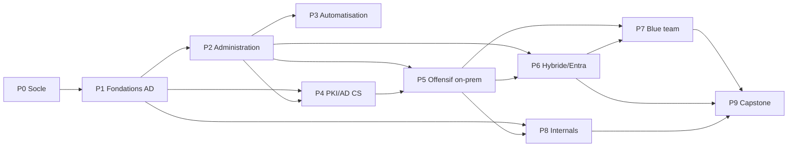

# 🧩 Carte de dépendances

Quel module avant quel autre. On ne saute pas une dépendance : un module d'attaque suppose
que le service correspondant a d'abord été **compris** et **construit** dans CORP.

## Règles

- **P0 → P1** : rien ne commence sans le socle (réseau isolé + Ludus + templates).
- **Comprendre/Construire avant Attaquer** : un module `attack.md` n'est abordé qu'après la
  `fiche.md` + `build.md` du même sujet.
- **P5 avant P7** : on apprend à détecter ce qu'on a d'abord su exécuter.
- **P4 (PKI propre) avant P4-ESC (attaques ADCS)** : comprendre la PKI avant de l'attaquer.
- **P9** réutilise tout : il se fait en dernier.
