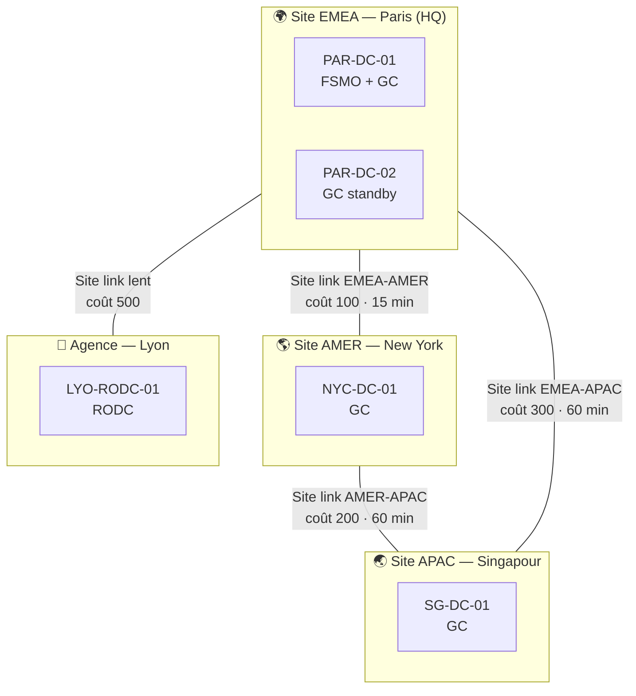
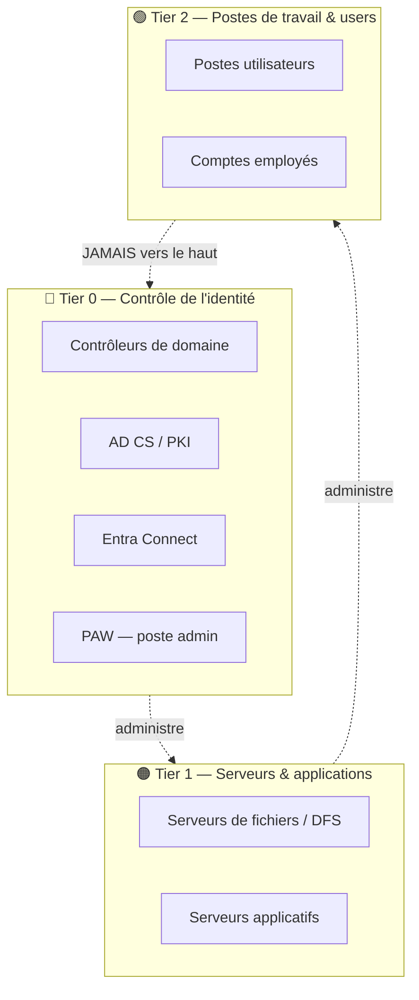

# 🏢 Architecture CORP — Entreprise internationale (lab de référence)

Société fictive : **Meridian Global** · Namespace AD interne : **`corp.meridian.com`**
(sous-domaine d'un domaine public détenu — jamais `.local`, conformément aux recommandations Microsoft).

Ce document décrit l'architecture **cible (logique)** d'un AD multinational, puis son
**mapping physique** sur le homelab Proxmox. On construit par phases : on ne déploie à un
instant T que le sous-ensemble nécessaire au module en cours.

---

## 1. Principes directeurs

1. **Forêt unique, domaine unique.** La géographie est gérée par les **Sites AD**, pas par
   des sous-domaines régionaux (le vieux modèle multi-domaines par pays est déconseillé).
2. **Enterprise Access Model** (modèle Tier 0/1/2) — remplace l'ancien « Red Forest/ESAE ».
   Isolation stricte du Tier 0, PAW, *clean source principle*.
3. **Moindre privilège & délégation** : administration régionale déléguée par OU, aucun
   compte à privilèges permanents inutiles.
4. **Résilience** : plusieurs DC par région, FSMO maîtrisés, sauvegarde/restauration testées.
5. **Réaliste, y compris le « sale »** : un scénario de fusion-acquisition (2ᵉ forêt + trust)
   pour reproduire la dette technique réelle d'une multinationale.

---

## 2. Forêt & domaine

| Élément | Choix | Pourquoi |
|---|---|---|
| Forêt | `meridian.com` (racine) | Frontière de sécurité réelle |
| Domaine de prod | `corp.meridian.com` | Domaine unique, géographie via Sites |
| Niveau fonctionnel | 2016 au départ → **2025** en Phase 9 | Voir l'évolution de la surface d'attaque |
| 2ᵉ forêt (M&A) | `nimbus.local` (acquisition) | Apprendre **forest trust** & attaques cross-forest |

> Évolution Server 2025 à étudier : nouveau niveau fonctionnel, comptes **dMSA**, dépréciation
> de **NTLM** et **WSUS**. On garde une partie du lab en 2016/2019 pour comparer.

---

## 3. Sites, réseaux & réplication (le cœur « international »)

Trois régions = trois **Sites AD**, plus une agence distante en RODC.



- **Sites & subnets** mappés aux VLAN Proxmox (voir §12).
- **Site links** avec **coûts** et **intervalles de réplication** différenciés → on observe
  concrètement la convergence, le KCC, l'ISTG, et les files de réplication (`repadmin`).
- **RODC** à Lyon : réplication unidirectionnelle, *Password Replication Policy*, mise en cache
  sélective — parfait pour comprendre les sites « moins sûrs ».

---

## 4. Contrôleurs de domaine & FSMO

| Rôle | Hôte | Site |
|---|---|---|
| Schema Master, Domain Naming | PAR-DC-01 | EMEA |
| PDC Emulator, RID, Infrastructure | PAR-DC-01 | EMEA |
| DC redondant / GC | PAR-DC-02 | EMEA |
| DC régional / GC | NYC-DC-01, SG-DC-01 | AMER, APAC |
| RODC | LYO-RODC-01 | Lyon |

Drills associés : **transfert** vs **saisie** des FSMO, *metadata cleanup* d'un DC mort,
restauration autoritaire/non-autoritaire (Phase 2 & sauvegarde/PRA).

---

## 5. Modèle de tiering (Enterprise Access Model)



Mise en œuvre : comptes admin **séparés par tier**, droits « *Deny log on* » croisés via GPO
(un admin Tier 0 ne peut pas ouvrir de session en Tier 1/2, et inversement) → casse les
chemins de vol de credentials. **PAW** obligatoire pour toute action Tier 0.

---

## 6. Structure d'OU

Tiering en haut, géographie en sous-OU (délégation régionale simple).

```
corp.meridian.com
├── OU=Admin
│   ├── OU=Tier0           (comptes & groupes admin AD/PKI, PAW)
│   ├── OU=Tier1           (admins serveurs)
│   └── OU=Tier2           (admins support postes)
├── OU=Employees
│   ├── OU=EMEA  ├── OU=AMER  └── OU=APAC
├── OU=Workstations
│   ├── OU=EMEA  ├── OU=AMER  └── OU=APAC
├── OU=Servers
│   ├── OU=Tier0           (DC, PKI, Entra Connect)
│   └── OU=Tier1           (FS, App) → sous-OU par région
├── OU=Groups
│   ├── OU=Roles           (groupes de rôle, globaux)
│   └── OU=Resources       (groupes de ressource, domain-local)
├── OU=ServiceAccounts     (gMSA / dMSA)
└── OU=Staging             (nouveaux objets avant classement)
```

Chaque OU régionale est **déléguée** à l'équipe locale (droits ciblés), ce qui donne aussi un
excellent terrain d'audit (chemins de privilège via délégations mal faites).

---

## 7. Stratégie de groupes & nommage

Modèle **AGDLP / IGDLA** (comptes → groupe global de rôle → groupe domain-local de ressource → permission).

| Type | Convention | Exemple |
|---|---|---|
| Groupe de rôle (global) | `R_<Role>` | `R_Finance_EMEA` |
| Groupe de ressource (domain-local) | `RES_<Ressource>_<Accès>` | `RES_FS-Finance_RW` |
| Groupe admin tier | `T<n>_<Scope>_Admins` | `T0_Domain_Admins` |
| Hôtes | `<SITE>-<RÔLE>-<##>` | `PAR-DC-01`, `NYC-FS-01` |

---

## 8. Stratégie GPO & baselines

- **Baselines de sécurité** : Microsoft Security Baselines / **CIS** + guide **ANSSI** (FR).
- **Enforcement du tiering** : droits « Allow/Deny log on locally & through RDP » par tier.
- **Windows LAPS** (intégré désormais) : rotation du mot de passe admin local.
- **PSO** (Fine-Grained Password Policies) : politique renforcée pour les comptes admin.
- **Audit policy baseline** : activée dès le départ pour alimenter la détection (Phase 7).
- **Paramètres « internationaux »** : fuseaux horaires, locales, formats régionaux par OU géo.

---

## 9. Services cœur

| Service | Rôle | Phase |
|---|---|---|
| **DNS AD-intégré** | Split-brain, forwarders conditionnels | P1 |
| **DHCP** (failover/split) | Baux par site | P1 |
| **DFS-N + DFS-R** | `\\corp.meridian.com\shares` répliqué inter-sites | P2 |
| **AD CS** (2 niveaux) | Root CA hors-ligne + Issuing CA | P4 |
| **Entra Connect** | Synchro hybride vers Entra ID | P6 |
| **PAW** | Poste d'admin Tier 0 | P2 |
| **Patching** | ⚠️ WSUS déprécié en 2025 → Azure Update Manager / WUfB | P2 |
| **Collecte de logs / SIEM** | Wazuh ou Elastic | P7 |

---

## 10. Comptes de service & secrets

- **gMSA** pour les services (mot de passe géré par AD), puis **dMSA** (Server 2025) pour voir
  la bascule — et la technique d'escalade associée publiée en 2025.
- Aucun secret en clair dans l'AD ni dans le dépôt. Coffre **KeePass** local (hors Git).

---

## 11. Trusts & scénario fusion-acquisition

Forêt `nimbus.local` (entreprise « rachetée ») reliée par **forest trust**. Permet d'étudier :
trusts transitifs/sélectifs, SID history, et les attaques cross-forest (abus de trust, Kerberos
inter-forêts). Déployée en Phase 5/6, pas au départ.

---

## 12. Plan d'adressage & VLAN (mapping Proxmox)

| Zone | Réseau | VLAN | Hôtes clés |
|---|---|---|---|
| EMEA (Paris, HQ) | `10.10.0.0/16` | 10 | PAR-DC-01/02, PAR-FS-01, PAR-CA-01, PAR-AADC-01 |
| AMER (New York) | `10.20.0.0/16` | 20 | NYC-DC-01, NYC-FS-01 |
| APAC (Singapour) | `10.30.0.0/16` | 30 | SG-DC-01 |
| Agence (Lyon) | `10.40.0.0/16` | 40 | LYO-RODC-01 |
| DMZ | `10.50.0.0/24` | 50 | (reverse proxy, services exposés simulés) |
| Forêt M&A (Nimbus) | `10.60.0.0/16` | 60 | NIM-DC-01 |
| Tier 0 / PAW | `10.99.0.0/24` | 99 | PAW-01, Root CA hors-ligne |
| GOAD-X (offensif) | `192.168.56.0/24` | 56 | lab GOAD isolé (via Ludus) |

Routage/isolation assurés par **OPNsense** (sur le HP ProLiant). GOAD-X **strictement isolé**.

---

## 13. Mapping physique : quoi déployer, quand

Build **incrémental** — on n'allume que le nécessaire (budget RAM très confortable sur 128 Go,
Server Core ≈ 2-4 Go, GUI ≈ 4-6 Go par VM).

| Phase | VM à ajouter | Objectif |
|---|---|---|
| P1 | PAR-DC-01 + 1 client Win | 1er DC, DNS/DHCP, objets de base |
| P1 | PAR-DC-02 | Redondance, réplication intra-site |
| P1 | NYC-DC-01 | **2ᵉ site** → réplication inter-sites (`repadmin`) |
| P2 | PAR-FS-01, PAW-01 | DFS, tiering, délégation, LAPS |
| P2 | LYO-RODC-01 | RODC & PRP |
| P4 | Root CA (hors-ligne) + PAR-CA-01 | PKI 2 niveaux |
| P6 | PAR-AADC-01 | Entra Connect (hybride) |
| P5 | NIM-DC-01 (forêt Nimbus) | Trust & cross-forest |

**MVP minimal pour commencer** : `PAR-DC-01` + 1 client. Tout le reste s'ajoute au fil des phases.

---

## 14. Definition of Done (construction CORP)

- [ ] Forêt/domaine `corp.meridian.com` déployés, niveau fonctionnel fixé
- [ ] ≥ 2 sites avec subnets, site links, réplication vérifiée (`repadmin /replsummary`)
- [ ] OU + délégation + groupes (AGDLP) en place
- [ ] Tiering appliqué (deny-logon croisés testés)
- [ ] GPO baselines + LAPS + audit policy actives
- [ ] DNS/DHCP/DFS fonctionnels
- [ ] Snapshot « known-good » de chaque VM + sauvegarde sur PBS
- [ ] Tout reconstructible en IaC (objectif Phase 3)
