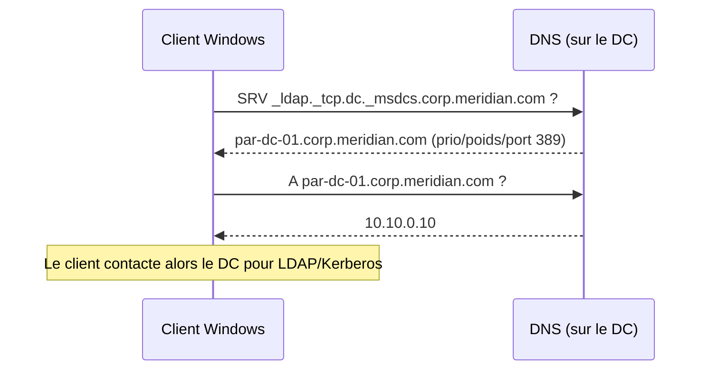

# Fiche — DNS (Domain Name System) dans Active Directory

> Volet académique. Le DNS est le **système nerveux** d'AD : sans lui, rien ne s'authentifie,
> rien ne se réplique. Ce module l'approfondit (le module 13 l'a installé au passage).

## 1. Rôle & utilité

Le DNS traduit des **noms** (`par-dc-01.corp.meridian.com`) en **adresses IP**, et surtout
publie **où** se trouvent les services du domaine via des enregistrements **SRV**. Un client
Windows qui démarre interroge le DNS pour trouver un DC, le KDC Kerberos, le Global Catalog…

## 2. Concepts clés

- **Zone** : une portion de l'espace de noms gérée par le serveur (ex. `corp.meridian.com`).
- **Zone directe** (A/AAAA) : nom → IP. **Zone inverse** (PTR) : IP → nom.
- **Enregistrements** : `A`/`AAAA` (hôte), `CNAME` (alias), `SRV` (localisation de service),
  `PTR` (inverse), `NS`/`SOA` (délégation/autorité), `TXT`.
- **Zone intégrée à AD** : stockée dans l'annuaire et **répliquée** avec AD (robuste, sécurisée).
- **Forwarder** : serveur en amont vers qui envoyer les requêtes externes (Internet).
- **Conditional forwarder** : forward ciblé pour un domaine précis (utile pour les **trusts**).
- **Scavenging / aging** : nettoyage des enregistrements dynamiques obsolètes.

## 3. Les SRV, cœur de la localisation de DC

Enregistrements SRV essentiels : `_ldap._tcp`, `_kerberos._tcp`, `_gc._tcp`, et les variantes
par site (`_sites`) qui permettent à un client de préférer un DC **de son site** (module 26).

## 4. DNS « split-brain » (interne vs externe)

`meridian.com` existe publiquement (site web, MX…) **et** en interne (`corp.meridian.com`).
L'astuce : le DNS **interne** résout les noms du domaine AD, et **forward** le reste vers
l'extérieur. On ne mélange jamais les deux zones.

## 5. Implémentation Windows
- **Rôle** : *DNS Server* (service `DNS`), administré par la console **DNS Manager** ou le
  module PowerShell **`DnsServer`**.
- **Port** : 53 (UDP/TCP).
- **Stockage** (zone AD-intégrée) : dans la partition d'annuaire `DomainDnsZones` / `ForestDnsZones`.

## 6. Objets & attributs AD liés
- Partitions d'application **`DomainDnsZones`** et **`ForestDnsZones`** (réplication des zones).
- Les DC enregistrent dynamiquement leurs SRV via le service **Netlogon**.

## 7. Surface d'attaque (aperçu)
- **Transfert de zone (AXFR)** non restreint → divulgation de toute la zone.
- **Mises à jour dynamiques non sécurisées** → un attaquant écrase un enregistrement (ex.
  `wpad`, usurpation de service).
- **DNS admins** : le groupe `DnsAdmins` a historiquement permis une exécution de code sur le DC
  (chargement de DLL) — à surveiller.
Détails et exploitation en Phase 5 ; ici on se limite à comprendre + durcir (`defend.md`).

## 8. Détection (aperçu)
Journaux DNS analytiques/d'audit, événements de mise à jour de zone, requêtes AXFR. Voir `defend.md`.

## 9. Versioning (2016 → 2025)
- **DNS policies** (2016+) : filtrage/redirection par critères.
- **DoH** côté client Windows plus récent.
- Bonnes pratiques constantes : zones AD-intégrées + mises à jour **sécurisées uniquement**.

## 10. Pour aller plus loin
Microsoft Learn — DNS Server ; *Mastering Active Directory* (DNS). Voir
`99-ressources/bibliographie.md` (P1).
