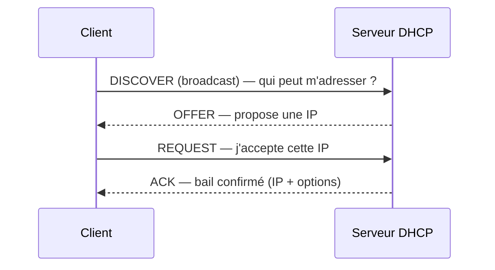

# Fiche — DHCP (Dynamic Host Configuration Protocol)

> Volet académique. DHCP attribue automatiquement les adresses IP aux clients. Secondaire pour
> un DC (IP fixe), mais essentiel pour les postes et pour comprendre l'intégration AD.

## 1. Rôle & utilité
DHCP fournit dynamiquement IP, masque, passerelle, serveurs DNS et options diverses aux clients.
Dans CORP, chaque site (EMEA/AMER/APAC) a son étendue (scope) correspondant à son sous-réseau.

## 2. Fonctionnement : le DORA

Port 67 (serveur) / 68 (client). Entre sous-réseaux, un **DHCP relay** (IP helper) transmet.

## 3. Concepts clés
- **Scope (étendue)** : plage d'IP distribuables pour un sous-réseau + options.
- **Réservation** : IP fixe liée à une adresse MAC.
- **Bail (lease)** : durée d'attribution.
- **Options** : 003 (routeur), 006 (DNS), 015 (domaine DNS), 066/067 (boot PXE)…
- **Autorisation DHCP dans AD** : un serveur DHCP Windows doit être **autorisé** dans l'annuaire
  pour servir (anti serveur pirate).
- **Haute dispo** : *DHCP Failover* (load-balance ou hot-standby) entre deux serveurs.
- **Mise à jour DNS dynamique** : le serveur DHCP peut enregistrer A/PTR pour les clients.

## 4. Implémentation Windows
- Rôle *DHCP Server*, console **DHCP** ou module PowerShell **`DhcpServer`**.
- Intégration AD : autorisation obligatoire (`Add-DhcpServerInDC`).

## 5. Objets & AD
- L'autorisation du serveur est stockée dans la partition de **configuration** de la forêt.

## 6. Surface d'attaque (aperçu)
- **Serveur DHCP pirate** (rogue) → distribue de mauvais DNS/passerelle (MITM).
- **DHCP starvation** → épuise le pool d'adresses (déni de service).
- **Mises à jour DNS dynamiques via DHCP** mal configurées → usurpation d'enregistrements.

## 7. Détection (aperçu)
Journaux DHCP (audit), événements d'autorisation, détection de serveurs rogue. Voir `defend.md`.

## 8. Versioning
Comportement stable ; en IPv6, DHCPv6 + SLAAC. Bonnes pratiques : failover + autorisation AD.

## 9. Pour aller plus loin
Microsoft Learn — DHCP ; voir `99-ressources/bibliographie.md` (P1).
