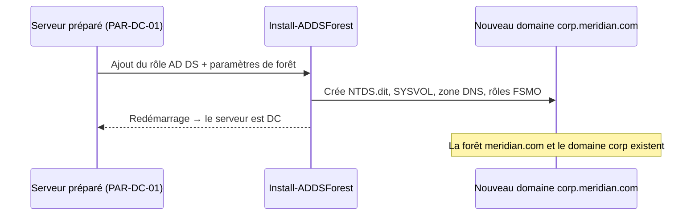

# Fiche — AD DS & promotion du premier contrôleur de domaine

> Volet académique. Comment naît un domaine : du serveur préparé (module 10) au premier DC
> opérationnel de `corp.meridian.com`.

## 1. Rôle & utilité

**AD DS (Active Directory Domain Services)** est l'annuaire central : il stocke les objets
(utilisateurs, ordinateurs, groupes), authentifie (Kerberos/NTLM) et autorise. Un serveur qui
héberge AD DS devient un **contrôleur de domaine (DC)**. Le **premier** DC *crée* la forêt et
le domaine : c'est l'acte fondateur.

## 2. Ce que « promouvoir » installe réellement

La promotion (`Install-ADDSForest`) met en place :
- La base de l'annuaire **NTDS.dit** (fichier `C:\Windows\NTDS\ntds.dit`) et ses journaux.
- Le dossier répliqué **SYSVOL** (scripts, GPO) répliqué par DFS-R.
- Le rôle **DNS** (en général intégré à l'AD) hébergeant la zone `corp.meridian.com`.
- Les **5 rôles FSMO** (tous sur ce premier DC au départ — voir module 28).
- Les partitions d'annuaire (Schema, Configuration, Domain).

## 3. Choix structurants à la création

- **Nom de forêt racine / domaine** : `corp.meridian.com` (voir `architecture.md` §2). On
  utilise un sous-domaine d'un domaine public détenu — **jamais** `.local`.
- **Niveau fonctionnel** de forêt/domaine : on démarre en **2016** (voir §Versioning).
- **Mot de passe DSRM** (Directory Services Restore Mode) : secret de récupération du DC, à
  conserver au coffre (**hors Git**).
- **NetBIOS** : nom court (`CORP`).

## 4. DNS : le compagnon obligatoire

AD **dépend** du DNS pour publier ses services via des enregistrements **SRV** (`_ldap`,
`_kerberos`, `_gc`…). Un DC est quasiment toujours aussi serveur DNS. Après promotion, le DC
doit pointer son **DNS client vers lui-même** (ou vers un autre DC). Les *forwarders* envoient
les requêtes externes vers un résolveur en amont.

## 5. Objets & attributs créés
- Conteneurs par défaut : `Users`, `Computers`, `Domain Controllers` (OU).
- Comptes clés : `Administrator`, **`krbtgt`** (chiffre les tickets Kerberos — cible du Golden
  Ticket, module 57), groupes `Domain Admins`, `Enterprise Admins`, `Schema Admins`.

## 6. Surface d'attaque (aperçu)
Dès qu'un DC existe, il expose Kerberos (88), LDAP (389/636), SMB (445, SYSVOL/NETLOGON), DNS
(53). C'est le cœur à défendre : compromettre un DC = compromettre le domaine. Détails dans les
modules offensifs (P5).

## 7. Détection (aperçu)
La promotion et les changements de rôle laissent des traces (installation de service 7045,
événements Directory Services). Le vrai sujet détection démarre en P7.

## 8. Versioning (2016 → 2025)
- **FL 2016** : base de référence stable.
- **2025** : nouveau FL (schéma v91), comptes **dMSA**, pages 32K, NUMA ; **NTLM déprécié**.
  On migrera CORP vers 2025 en Phase 9 pour comparer la surface d'attaque.

## 9. Pour aller plus loin
*Mastering Active Directory* (conception forêt/domaine, DNS), Microsoft Learn — AD DS.
Voir `99-ressources/bibliographie.md` (P1).
