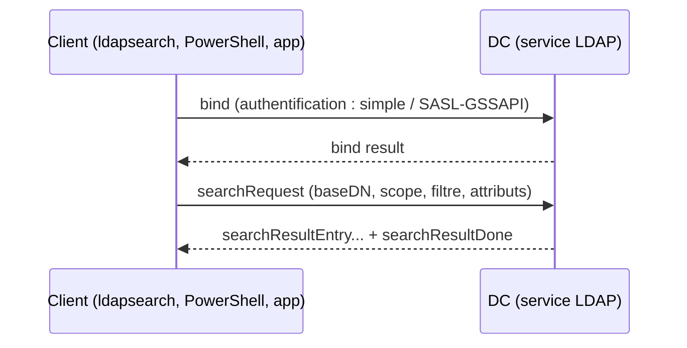

# Fiche — LDAP (Lightweight Directory Access Protocol)

> Volet académique. LDAP est le **langage d'accès** à l'annuaire AD : lire, chercher, modifier
> les objets. Tout outil d'administration ou d'attaque AD parle LDAP sous le capot.

## 1. Rôle & utilité
LDAP est le protocole par lequel clients et applications interrogent/modifient l'annuaire.
AD DS expose un service LDAP sur chaque DC.

## 2. Fonctionnement

## 3. Concepts clés
- **DN / RDN** : chemin de l'objet (`CN=Jon Snow,OU=EMEA,...`).
- **baseDN** + **scope** (`base`, `one`, `sub`) : où chercher.
- **Filtres LDAP** : `(objectClass=user)`, `(&(objectClass=user)(memberOf=...))`,
  matching rules (ex. `userAccountControl:1.2.840.113556.1.4.803:=...` pour les bits).
- **Bind** : *simple* (identifiant+mot de passe, à protéger par TLS) ou *SASL/GSSAPI* (Kerberos).
- **Ports** : 389 (LDAP), 636 (**LDAPS**), 3268/3269 (**Global Catalog**).
- **Signature & channel binding** : protègent contre l'interception et le relais.

## 4. Implémentation Windows
- Service LDAP intégré au DC. Côté client : module `ActiveDirectory`, `ldp.exe`, ADSI Edit,
  `System.DirectoryServices` (.NET), `ldapsearch` (Linux).

## 5. Objets & attributs
Toute la base AD est adressable en LDAP. Attributs sensibles souvent requêtés :
`servicePrincipalName`, `userAccountControl`, `memberOf`, `msDS-AllowedToActOnBehalfOfOtherIdentity`,
`msDS-KeyCredentialLink`, `adminCount`.

## 6. Surface d'attaque (aperçu)
- **Bind anonyme / null** → énumération sans compte (sur domaines hérités).
- **Requêtes de reconnaissance** (BloodHound/SharpHound collectent massivement via LDAP).
- **LDAP non signé** → cible de **relais NTLM** vers LDAP (ex. création de RBCD) — module 54.
- **LDAP injection** côté applications mal codées.

## 7. Détection (aperçu)
Audit des requêtes coûteuses/inefficaces (Directory Service 1644), volumes anormaux de requêtes,
binds non sécurisés. Voir `defend.md`.

## 8. Versioning
- Durcissements récents : **LDAP channel binding** et **signing** de plus en plus imposés par
  défaut/patchs. Bonne pratique : exiger la signature + LDAPS.

## 9. Pour aller plus loin
Microsoft Learn — LDAP ; *The Hacker Recipes* (LDAP). Voir `99-ressources/bibliographie.md` (P1, P5).
