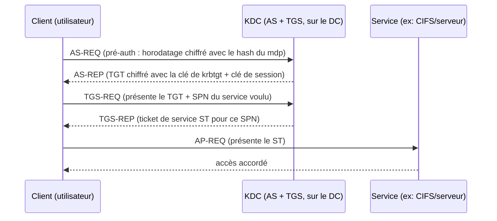

# Fiche — Kerberos (introduction)

> Volet académique. Kerberos est le protocole d'authentification **par défaut** d'AD. Le
> comprendre est indispensable : la majorité des attaques AD modernes le ciblent.

## 1. Rôle & utilité
Kerberos authentifie un utilisateur/service **sans transmettre le mot de passe** sur le réseau,
grâce à des **tickets** chiffrés délivrés par le **KDC** (hébergé sur chaque DC).

## 2. Les trois acteurs & les échanges (AS / TGS)

## 3. Notions essentielles
- **KDC** : Key Distribution Center = **AS** (Authentication Service) + **TGS** (Ticket Granting Service).
- **TGT** : ticket initial, chiffré avec la clé du compte **krbtgt**.
- **ST (TGS)** : ticket pour un service identifié par son **SPN**.
- **PAC** : dans le ticket, porte les SID/groupes (autorisation).
- **Pré-authentification** : prouve la connaissance du mot de passe dès l'AS-REQ (si désactivée →
  AS-REP roasting).
- **Clé de session**, **horodatage** (tolérance ≤ 5 min → l'heure est critique).
- **Port** : 88.

## 4. Pourquoi c'est la cible n°1 (aperçu, détaillé en P5)
- **Kerberoasting** : demander un ST pour un compte à SPN, puis casser hors-ligne le ST
  (chiffré avec le hash du compte de service).
- **AS-REP roasting** : pour un compte sans pré-auth, l'AS-REP est cassable hors-ligne.
- **Golden Ticket** : avec la clé **krbtgt**, forger n'importe quel TGT.
- **Silver Ticket** : avec la clé d'un service, forger un ST pour ce service.
- **Délégation** (unconstrained/constrained/**RBCD**) : abus des mécanismes de délégation Kerberos.

## 5. Implémentation Windows
- KDC sur le DC ; côté client, SSPI/`LSASS`. Outils d'observation : `klist` (tickets en cache),
  `Get-WinEvent` (4768/4769/4771).
- Chiffrements : privilégier **AES** ; **RC4** est hérité et facilite certaines attaques.

## 6. Objets & attributs liés
- Compte **krbtgt** (clé des TGT), **servicePrincipalName** (comptes de service),
  `msDS-SupportedEncryptionTypes`, flags `userAccountControl` (DONT_REQ_PREAUTH, délégations).

## 7. Détection (aperçu)
4768 (TGT demandé), 4769 (ST demandé — Kerberoasting), 4771 (échec pré-auth), chiffrement RC4
anormal, tickets au cycle de vie suspect. Voir `defend.md`.

## 8. Versioning (2016 → 2025)
- Durcissement **PAC** (correctifs 2021-2022, imposition progressive).
- Server 2025 : **IAKerb**, **KDC local**, SPN par IP — réduire NTLM au profit de Kerberos.

## 9. Pour aller plus loin
*Pentesting AD* (Kerberos), *The Hacker Recipes* (Kerberos), ADSecurity.org.
Voir `99-ressources/bibliographie.md` (P1, P5).
