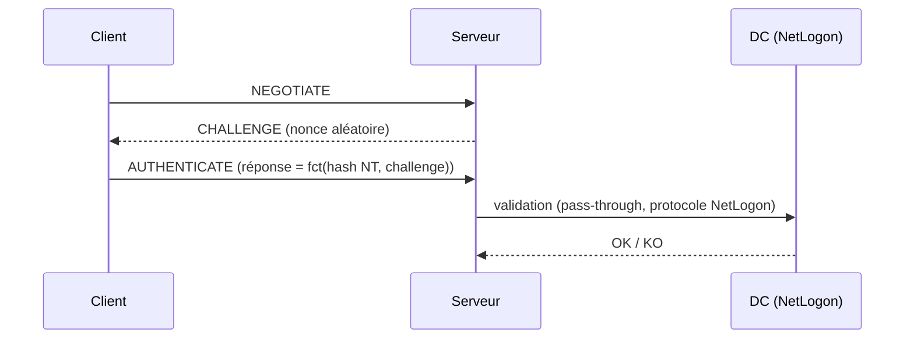

# Fiche — NTLM (introduction)

> Volet académique. NTLM est le protocole d'authentification **hérité** de Windows. Kerberos
> l'a remplacé, mais NTLM reste très présent — et très abusé. **Déprécié à partir de 2025.**

## 1. Rôle & utilité
NTLM authentifie par **défi/réponse** sans envoyer le mot de passe. Utilisé quand Kerberos n'est
pas possible (accès par IP, pas de SPN, hôte hors domaine, applications héritées).

## 2. Fonctionnement (défi/réponse)

## 3. Notions essentielles
- **Hash NT** : empreinte du mot de passe, **suffisante** pour s'authentifier (→ Pass-the-Hash).
- **NetNTLMv1 / v2** : réponses défi/réponse capturables sur le réseau (→ cassage ou relais).
- **Pas de PAC/Kerberos** : autorisation via pass-through au DC.
- Transport fréquent : **SMB (445)**, HTTP(S), LDAP, etc.

## 4. Pourquoi NTLM est dangereux (aperçu, détaillé en P5)
- **Pass-the-Hash (PtH)** : le hash NT seul permet l'authentification (pas besoin du mot de passe).
- **Capture + cassage** : Responder capture des NetNTLMv2 (empoisonnement LLMNR/NBT-NS), cassés hors-ligne.
- **Relais NTLM** : relayer l'authentification vers un autre service (SMB/LDAP/AD CS) → ex. RBCD,
  ESC8. Rendu possible quand la **signature** n'est pas imposée.

## 5. Implémentation Windows
- Fournisseur SSP `msv1_0` dans **LSASS** ; validation via **NetLogon** sur le DC.
- Audit via la stratégie **NTLM auditing** (restriction NTLM).

## 6. Objets & attributs liés
- Hash NT stocké dans la base **SAM** (local) et **NTDS.dit** (domaine).
- Politiques : *Network security: Restrict NTLM* (audit puis blocage).

## 7. Détection (aperçu)
4624/4625 avec package d'authentification NTLM, événements de restriction NTLM (8001-8004),
LLMNR/NBT-NS poisoning. Voir `defend.md`.

## 8. Versioning (2016 → 2025)
- **2025 : NTLM est déprécié** (Microsoft pousse Kerberos : IAKerb, KDC local, SPN par IP).
- Plan recommandé : **auditer** l'usage NTLM, puis **restreindre/bloquer** progressivement.

## 9. Pour aller plus loin
*Windows Security Internals* (auth), *Pentesting AD* (NTLM/relais), *The Hacker Recipes*.
Voir `99-ressources/bibliographie.md` (P1, P5, P8).
