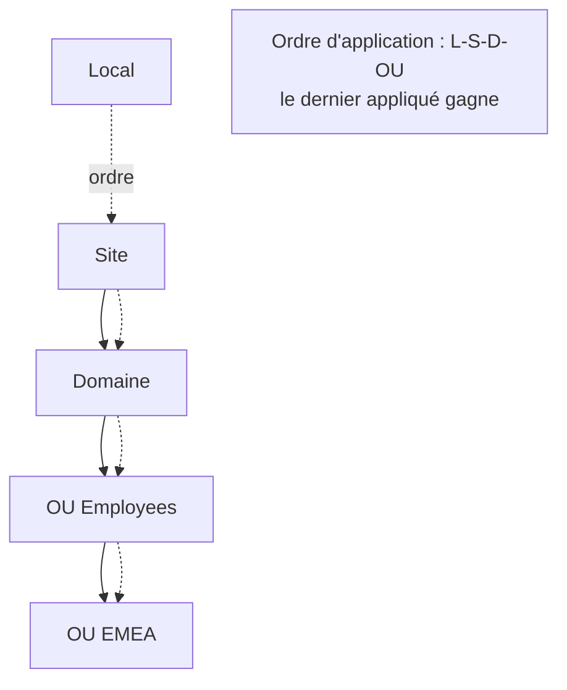

# Fiche — GPO (Group Policy Objects)

> Volet académique. Les GPO sont le moyen central de **configurer et sécuriser** en masse les
> utilisateurs et ordinateurs du domaine. Base de tout durcissement (tiering, LAPS, audit…).

## 1. Rôle & utilité
Une GPO est un ensemble de paramètres (sécurité, logiciels, scripts, préférences) appliqués
automatiquement aux objets d'un périmètre (site, domaine, OU). C'est l'outil n°1 de
l'administrateur pour imposer une configuration cohérente.

## 2. Fonctionnement : liaison & application

- **Ordre LSDOU** : Local → Site → Domaine → OU (la GPO la plus proche de l'objet l'emporte).
- **Deux moitiés** : *Computer Configuration* (à l'ouverture/au boot) et *User Configuration* (au logon).
- **Enforced** (ne peut être écrasée) et **Block Inheritance** (bloque l'héritage sur une OU).
- **Filtrage** : par **groupe de sécurité** (ACL de la GPO) ou par **WMI filter**.
- **Rafraîchissement** : au boot/logon + toutes les ~90 min (aléa 0-30) ; `gpupdate /force` à la demande.

## 3. Anatomie technique
- **GPC** (Group Policy Container) : objet dans AD (métadonnées, version).
- **GPT** (Group Policy Template) : fichiers dans **SYSVOL** (`\\domaine\SYSVOL\...\Policies\{GUID}`).
- Les deux doivent rester synchronisés (numéro de version) — sinon dysfonctionnements.

## 4. Catégories de paramètres utiles
- **Security Settings** : droits utilisateur, options de sécurité, pare-feu, Audit policy.
- **Administrative Templates** (ADMX) : réglages du registre documentés.
- **Preferences (GPP)** : lecteurs mappés, imprimantes, clés registre, tâches planifiées.
- **Scripts** : démarrage/arrêt, logon/logoff.

## 5. Implémentation Windows
- Console **GPMC** (`gpmc.msc`), éditeur **GPME**. Module PowerShell **`GroupPolicy`**
  (`New-GPO`, `New-GPLink`, `Set-GPRegistryValue`, `Get-GPResultantSetOfPolicy`).
- Stockage : GPC (AD) + GPT (SYSVOL, répliqué par DFS-R).

## 6. Objets & attributs liés
- Objets `groupPolicyContainer` ; attribut `gPLink` sur les OU/site/domaine ; `versionNumber`.

## 7. Surface d'attaque (aperçu)
- **Écriture sur une GPO liée** = exécution de code sur toutes les cibles (escalade massive ;
  outil SharpGPOAbuse). Les droits d'édition de GPO sont donc **Tier 0-sensibles**.
- **GPP cpassword** (hérité) : mots de passe chiffrés avec une clé publique → déchiffrables
  (ne jamais stocker de secret en GPP).
- **SYSVOL en lecture** : un user authentifié lit les GPT (fuite d'infos/secrets).

## 8. Détection (aperçu)
Création/modification de GPO (5136/5137 si audit objet), modification du gPLink, changements de
version. Voir `defend.md`.

## 9. Versioning
- **LAPS** moderne, baselines de sécurité livrées en GPO (Microsoft Security Baselines).
- Tendance : coexistence avec la gestion moderne (Intune) côté postes.

## 10. Pour aller plus loin
Microsoft Learn — Group Policy ; Microsoft Security Compliance Toolkit (baselines).
Voir `99-ressources/bibliographie.md` (P2).
