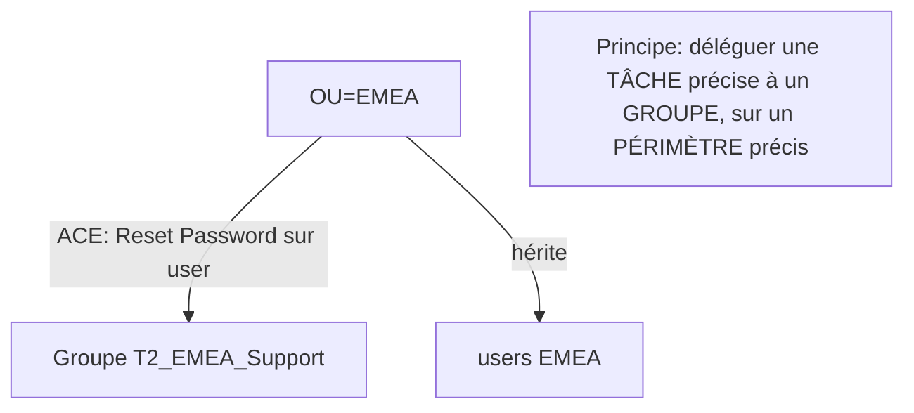

# Fiche — OU & délégation d'administration

> Volet académique. Les OU organisent l'annuaire et servent de point d'application des GPO **et**
> de délégation de droits. Une délégation mal faite = chemin d'escalade silencieux.

## 1. Rôle & utilité
Une **OU** (Organizational Unit) est un conteneur. Elle permet : d'appliquer des GPO à un
périmètre, et de **déléguer** des tâches d'administration (ex. "le support EMEA peut réinitialiser
les mots de passe des users EMEA") sans donner de droits globaux.

## 2. Le modèle de délégation
La délégation repose sur les **ACL** (Access Control Lists) posées sur l'OU et héritées par ses
objets. On accorde des **permissions ciblées** (ex. *Reset Password* sur les objets user de l'OU)
à un **groupe** — jamais à un individu.

## 3. Concepts clés
- **ACE (Access Control Entry)** : une entrée d'ACL (qui, quoi, hérité ou non).
- **Permissions étendues** : droits AD spécifiques (Reset Password, Unlock, "Create/Delete user
  objects", "Read/Write property" sur un attribut précis).
- **Héritage** : une ACE sur l'OU s'applique aux objets enfants selon sa portée.
- **Assistant de délégation** (ADUC) vs édition fine (onglet Security / `dsacls`).
- **AdminSDHolder / SDProp** : les comptes des groupes protégés voient leurs ACL **réécrites**
  périodiquement (toute délégation sur eux est annulée — par conception).

## 4. Bonnes pratiques
- Déléguer à des **groupes** (jamais des comptes), nommés clairement (ex. `T2_EMEA_PwdReset`).
- **Tâches minimales** (moindre privilège) sur le **périmètre minimal** (l'OU concernée).
- Documenter chaque délégation ; auditer régulièrement (dérive = risque).

## 5. Implémentation Windows
- **ADUC** (Delegate Control Wizard), onglet **Security** (avancé), **`dsacls`**,
  PowerShell (`Get-Acl`/`Set-Acl` sur `AD:` provider, module `ActiveDirectory`).

## 6. Objets & attributs liés
- `nTSecurityDescriptor` (le descripteur de sécurité de l'objet), ACE héritées, `adminCount`
  (marqueur des objets protégés par SDProp).

## 7. Surface d'attaque (aperçu)
- **ACL excessives** : *GenericAll*, *WriteDACL*, *WriteOwner*, *Reset Password*,
  *AddMember*… posées par erreur = escalade (BloodHound les met en évidence).
- **Délégation sur une OU contenant des comptes sensibles** = prise de contrôle.
- Droits d'écriture sur `msDS-KeyCredentialLink` → Shadow Credentials (P5).

## 8. Détection (aperçu)
Modification de descripteur de sécurité (5136 sur `nTSecurityDescriptor`), réinitialisations de
mot de passe (4724), ajouts de membres. Voir `defend.md`.

## 9. Versioning
Stable. Les outils d'audit (BloodHound, PingCastle) rendent la revue des ACL systématique.

## 10. Pour aller plus loin
Microsoft Learn — Delegation ; *The Hacker Recipes* (ACL abuse). Voir `bibliographie.md` (P2, P5).
