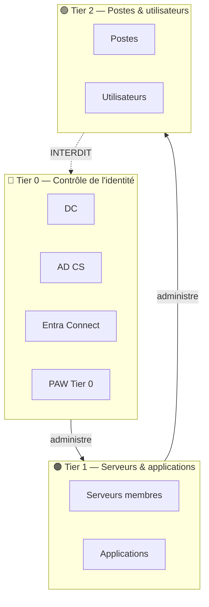

# Fiche — Modèle de tiering (Enterprise Access Model)

> Volet académique. Le tiering est **la** mesure structurante contre le vol de credentials et
> l'escalade vers Domain Admins. C'est le cœur défensif de CORP.

## 1. Rôle & utilité
Le problème : si un admin de domaine ouvre une session sur un poste utilisateur compromis, son
credential (TGT/hash) peut être volé → compromission totale. Le **tiering** isole les plans
d'administration pour qu'un compromis « en bas » ne remonte jamais « en haut ».

## 2. Les trois tiers

- **Tier 0** : tout ce qui contrôle l'identité (DC, AD CS, Entra Connect, comptes/ groupes
  d'admin de l'annuaire). Compromis = jeu terminé.
- **Tier 1** : serveurs et applications (fichiers, bases, applicatifs).
- **Tier 2** : postes de travail et comptes utilisateurs.

## 3. Les règles d'or
1. **Comptes séparés par tier** : un admin a un compte distinct par tier (`adm-t0-*`, `adm-t1-*`…),
   jamais réutilisé ailleurs. Le compte Tier 0 ne sert QUE sur des systèmes Tier 0.
2. **Pas d'ouverture de session descendante** : un credential Tier 0 ne doit JAMAIS apparaître
   sur un système Tier 1/2 (où il pourrait être volé). → "clean source principle".
3. **PAW (Privileged Access Workstation)** : l'administration Tier 0 se fait depuis un poste dédié,
   durci, isolé (pas de mail/web).
4. **Interdictions croisées via GPO** : *Deny log on* empêche techniquement les mauvaises sessions.

## 4. Mise en œuvre par GPO (deny logon)
Pour chaque tier, on refuse l'ouverture de session des comptes des **autres** tiers :
- Sur les **DC/Tier 0** : deny logon pour les groupes admin Tier 1 et Tier 2.
- Sur les **serveurs Tier 1** : deny logon pour Tier 0 (le T0 ne se connecte pas en T1) et Tier 2.
- Sur les **postes Tier 2** : deny logon pour Tier 0 et Tier 1.
Droits concernés : *Deny log on locally*, *Deny log on through RDP*, *Deny log on as a batch/service*.

## 5. Composants associés
- **Authentication Policies & Silos** (Kerberos) : enfermer les comptes Tier 0 dans un silo qui
  limite où leurs TGT sont utilisables + TGT courts.
- **Protected Users** : force AES, interdit NTLM/délégation pour les comptes sensibles.
- **LAPS** (module 24) : mots de passe admin locaux uniques (empêche le rebond latéral Tier 2).

## 6. Implémentation Windows
- OU dédiées par tier (voir `architecture.md` §6), groupes `T0/T1/T2_*_Admins`, GPO de deny logon,
  silos d'authentification (`New-ADAuthenticationPolicy`, `New-ADAuthenticationPolicySilo`).

## 7. Surface d'attaque que ça ferme
- **Pass-the-Hash / Pass-the-Ticket latéral** (vol de credential admin sur un poste).
- **Escalade Tier 2 → Tier 0** par réutilisation de comptes.
- Rend les chemins BloodHound vers le Tier 0 beaucoup plus rares.

## 8. Détection (aperçu)
Ouvertures de session de comptes Tier 0 hors Tier 0 (anomalie forte), échecs de deny logon
(4625), usage de comptes d'admin sur des hôtes inattendus. Voir `defend.md`.

## 9. Versioning
L'**Enterprise Access Model** remplace l'ancien **ESAE/Red Forest**. Les silos
d'authentification existent depuis 2012 R2 ; Protected Users aussi.

## 10. Pour aller plus loin
Microsoft — Securing Privileged Access / Enterprise Access Model ; Trimarc.
Voir `99-ressources/bibliographie.md` (P2, P7).
