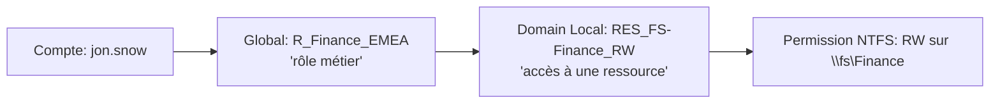

# Fiche — Stratégie de groupes & modèle AGDLP

> Volet académique. Bien structurer les groupes est ce qui rend les permissions **maintenables**
> et **auditables** à l'échelle d'une multinationale. Le module 14 a introduit les groupes ; ici
> on en fait une vraie stratégie.

## 1. Rôle & utilité
Les groupes relient des **comptes** à des **permissions**. Sans méthode, on finit avec des droits
posés directement sur des comptes/ressources, impossibles à auditer. Le modèle **AGDLP** impose
une chaîne claire.

## 2. AGDLP / IGDLA
**A**ccount → **G**lobal group (rôle métier) → **D**omain **L**ocal group (ressource) → **P**ermission.
(IGDLA = la même chose lue dans l'autre sens, avec I=Identity.)

- **Global (rôle)** : regroupe les comptes qui ont la **même fonction** (ex. Finance EMEA).
- **Domain Local (ressource)** : représente un **accès** à une ressource (ex. RW sur un partage).
- On place le **global dans le domain local**, et on pose la **permission sur le domain local**.

## 3. Pourquoi c'est supérieur
- **Lisibilité** : pour savoir qui accède à une ressource, on lit UN domain local.
- **Évolutivité multi-domaines/forêt** : les globaux/universels traversent, les domain locals
  cadrent l'accès local. En multi-domaine, on insère parfois un **Universal** (schéma AGUDLP).
- **Audit** : les revues d'accès deviennent mécaniques.

## 4. Type & portée (rappel)
- **Type** : Sécurité (ACL) vs Distribution (mail).
- **Portée** : Global / Domain Local / Universal (voir module 14, §4).
- **Universal** : stocké au **Global Catalog** → attention à la réplication si usage massif.

## 5. Conventions de nommage (CORP)
- Rôle (global) : `R_<Fonction>_<Région>` (ex. `R_Finance_EMEA`).
- Ressource (domain local) : `RES_<Ressource>_<Accès>` (ex. `RES_FS-Finance_RW`).
- Admin par tier : `T<n>_<Scope>_Admins`.

## 6. Implémentation Windows
- Module `ActiveDirectory` (`New-ADGroup`, `Add-ADGroupMember`), ADUC/ADAC.
- Revue : `Get-ADGroupMember`, rapports d'appartenance.

## 7. Surface d'attaque (aperçu)
- **Nested groups** profonds → appartenances effectives difficiles à voir (BloodHound les déplie).
- **Groupes imbriqués dans des groupes à privilèges** → escalade cachée.
- **Token bloat** (trop d'appartenances) → problèmes Kerberos (taille du PAC) et risque d'oubli.

## 8. Détection (aperçu)
Ajouts/suppressions de membres (4728/4729/4732/4733/4756/4757), surtout pour les groupes
sensibles. Voir `defend.md`.

## 9. Versioning
Stable. Les revues d'accès automatisées (et côté cloud, les Access Reviews d'Entra, P6) prolongent
cette logique.

## 10. Pour aller plus loin
Microsoft Learn — Group scopes ; *Mastering AD*. Voir `99-ressources/bibliographie.md` (P2).
