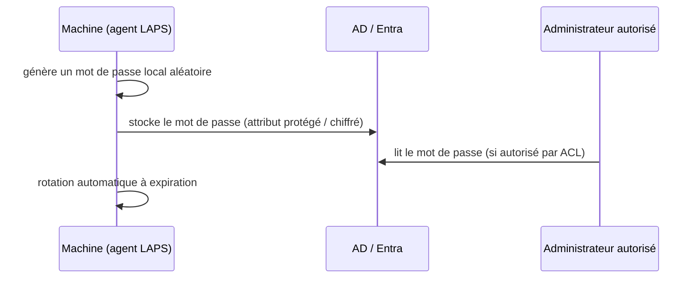

# Fiche — Windows LAPS (Local Administrator Password Solution)

> Volet académique. LAPS casse le **rebond latéral** entre machines : chaque poste/serveur a un
> mot de passe administrateur **local unique**, aléatoire et renouvelé, stocké de façon sécurisée.

## 1. Rôle & utilité
Problème classique : le même mot de passe admin local partout → un hash volé sur un poste
(Pass-the-Hash) ouvre **tous** les autres. LAPS attribue à chaque machine un mot de passe local
distinct, géré automatiquement.

## 2. Fonctionnement

## 3. Windows LAPS (moderne) vs Legacy LAPS
- **Windows LAPS** : **intégré** à Windows (2019+ patché, 2022, 2025, Win10/11 récents). Supporte
  le stockage dans **AD** *ou* **Entra ID**, le **chiffrement** du mot de passe (groupe autorisé),
  l'historique, et la sauvegarde du mot de passe **DSRM** d'un DC.
- **Legacy LAPS** (ancien MSI) : stockage AD en clair dans `ms-Mcs-AdmPwd` (lisible par ACL).
  À migrer vers Windows LAPS.

## 4. Concepts clés
- **Attributs AD** (Windows LAPS) : `msLAPS-Password`, `msLAPS-EncryptedPassword`,
  `msLAPS-PasswordExpirationTime` (legacy : `ms-Mcs-AdmPwd`).
- **Chiffrement** : le mot de passe peut être chiffré pour un groupe/principal (déchiffrable
  uniquement par lui) → même un lecteur d'annuaire ne le voit pas en clair.
- **Politique** : longueur, complexité, âge, rotation post-lecture.
- **Autorisation de lecture** : via ACL sur l'OU des machines.

## 5. Implémentation Windows
- Configuration par **GPO** (Windows LAPS a ses propres ADMX intégrés) ou **Intune**.
- Extension de schéma : `Update-LapsADSchema`. Octroi de lecture : `Set-LapsADReadPasswordPermission`.
- Récupération : `Get-LapsADPassword`.

## 6. Objets & attributs liés
- Attributs `msLAPS-*` sur l'objet **ordinateur** ; ACL sur l'OU qui autorise la lecture.

## 7. Surface d'attaque (aperçu)
- **Legacy LAPS mal délégué** : `ms-Mcs-AdmPwd` lisible par trop de principals = tous les mots de
  passe locaux exposés.
- **Lecture du mot de passe LAPS** par un compte compromis ayant l'ACL → admin local de la cible.
- Sans LAPS : **mot de passe local partagé** → Pass-the-Hash généralisé.

## 8. Détection (aperçu)
Lectures de l'attribut mot de passe (audit d'accès à l'attribut, 4662/5136), expirations/rotations.
Voir `defend.md`.

## 9. Versioning (2016 → 2025)
- **Windows LAPS** recommandé (abandonner Legacy LAPS). Stockage Entra pour les machines jointes
  Entra (P6). 2025 : intégration consolidée.

## 10. Pour aller plus loin
Microsoft Learn — Windows LAPS. Voir `99-ressources/bibliographie.md` (P2).
