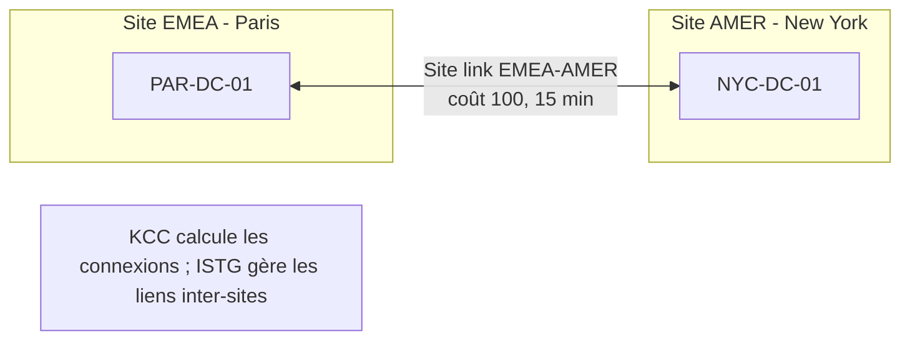

# Fiche — Sites AD & réplication

> Volet académique. Les Sites modélisent la **topologie réseau** pour localiser les services et
> piloter la **réplication** entre DC — le cœur « international » de CORP.

## 1. Rôle & utilité
Un **Site** AD = un ou plusieurs sous-réseaux « bien connectés ». Les sites servent à :
- **Localiser** les services (un client s'authentifie auprès d'un DC de son site) ;
- **Contrôler la réplication** (fréquence/coût entre sites distants) ;
- Diriger DFS, SYSVOL, etc. vers la ressource locale.

## 2. Topologie & composants

- **Subnets** : associent une plage IP à un site.
- **Site links** : relient des sites, avec un **coût** (préférence) et un **intervalle** de réplication.
- **KCC (Knowledge Consistency Checker)** : calcule automatiquement la topologie de réplication.
- **ISTG (Inter-Site Topology Generator)** : gère les connexions inter-sites.
- **Bridgehead servers** : DC qui portent la réplication inter-sites.

## 3. Réplication : intra vs inter-site
- **Intra-site** : quasi immédiate (notification ~15 s), non compressée.
- **Inter-site** : planifiée (selon l'intervalle du site link), compressée.
- **Multi-maître** : tout DC inscriptible accepte les écritures ; convergence par **USN** +
  **métadonnées de version** (résolution de conflits déterministe).
- **Urgent replication** : certains changements (verrouillage de compte, modif de mot de passe via
  PDC) se propagent en priorité.

## 4. Concepts clés
- **USN (Update Sequence Number)**, **high-water mark**, **up-to-dateness vector**.
- **Connection objects** (créés par KCC ou manuels).
- **Partitions** répliquées : Schema & Configuration (forêt entière), Domain (par domaine),
  application (DNS).

## 5. Implémentation Windows
- Console **Sites and Services** (`dssite.msc`), **`repadmin`**, **`dcdiag`**, module PowerShell
  `ActiveDirectory` (`Get-ADReplication*`).

## 6. Objets & attributs AD liés
- Objets site/subnet/siteLink/ nTDSConnection dans la partition **Configuration**.

## 7. Surface d'attaque (aperçu)
- **DCShadow** (P5) : un attaquant simule un DC pour **injecter** des changements via la réplication.
- **DCSync** (P5) : abuse de la réplication (`Get-ADReplicationAccount`) pour extraire les secrets
  (droits *Replicating Directory Changes*).
- Lecture des droits de réplication = cible de durcissement.

## 8. Détection (aperçu)
Réplication anormale/depuis un hôte non-DC (DCSync/DCShadow), échecs de réplication, latence.
Voir `defend.md`.

## 9. Versioning (2016 → 2025)
- **2025** : *replication priority boost*, nouveaux compteurs, NUMA → meilleures perfs sur grandes
  forêts. Fondamentaux inchangés.

## 10. Pour aller plus loin
Microsoft Learn — AD Replication ; *Mastering AD* (sites). Voir `99-ressources/bibliographie.md` (P2).
