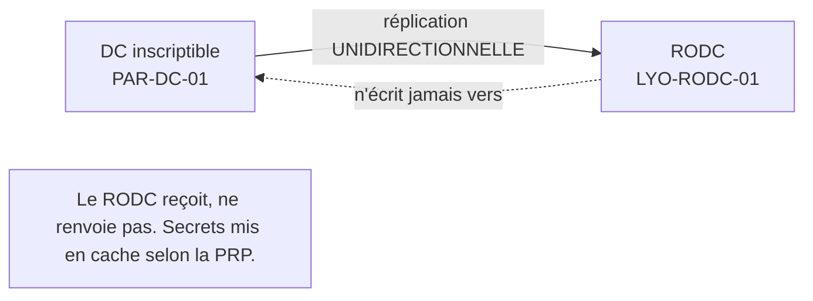

# Fiche — RODC (Read-Only Domain Controller)

> Volet académique. Le RODC est un DC en **lecture seule** pour les sites « moins sûrs »
> (agence, site exposé). Dans CORP : l'agence de Lyon.

## 1. Rôle & utilité
Dans un site peu sécurisé physiquement, un DC classique est risqué (vol = secrets du domaine).
Le **RODC** réplique l'annuaire **en lecture seule**, ne stocke **pas** les secrets par défaut, et
limite les dégâts en cas de compromission.

## 2. Caractéristiques

- **Réplication unidirectionnelle** (reçoit seulement).
- **Pas de secrets par défaut** ; mise en cache sélective via la **PRP**.
- **Password Replication Policy (PRP)** : liste *Allowed*/*Denied* des comptes dont le secret peut
  être mis en cache localement.
- **Administration déléguée locale** (role separation) sans être admin du domaine.
- **Filtered Attribute Set** : empêche la réplication de certains attributs sensibles vers le RODC.

## 3. Fonctionnement d'une authentification au RODC
1. L'utilisateur s'authentifie au RODC.
2. Si son secret est **en cache** (autorisé par PRP) → le RODC traite localement.
3. Sinon → le RODC transmet au DC inscriptible, et met éventuellement en cache (si PRP l'autorise).

## 4. Concepts clés
- **krbtgt dédié** au RODC (compte `krbtgt_<id>`), isolé du krbtgt du domaine.
- **Comptes à NE PAS mettre en cache** : comptes sensibles/Tier 0 (jamais sur un RODC).
- **Compromission d'un RODC** : seuls les secrets mis en cache sont exposés (d'où l'importance de la PRP).

## 5. Implémentation Windows
- Promotion : `Install-ADDSDomainController -ReadOnlyReplica`. Pré-staging du compte RODC possible.
- PRP gérée via ADUC (onglet Password Replication Policy) ou PowerShell.

## 6. Objets & attributs liés
- Groupes *Allowed RODC Password Replication Group* / *Denied...* ; attribut
  `msDS-RevealOnDemandGroup` / `msDS-NeverRevealGroup` sur l'objet RODC.

## 7. Surface d'attaque (aperçu)
- **Vol d'un RODC** → extraction des secrets **mis en cache** (si PRP trop permissive).
- **PRP mal configurée** (Allowed trop large, comptes sensibles en cache) = fuite majeure.
- Abus du krbtgt du RODC (portée limitée mais réelle).

## 8. Détection (aperçu)
Surveillance des comptes révélés/mis en cache par le RODC, tentatives d'écriture, PRP. Voir `defend.md`.

## 9. Versioning
Stable depuis 2008. Reste pertinent pour agences/sites exposés.

## 10. Pour aller plus loin
Microsoft Learn — RODC. Voir `99-ressources/bibliographie.md` (P2).
