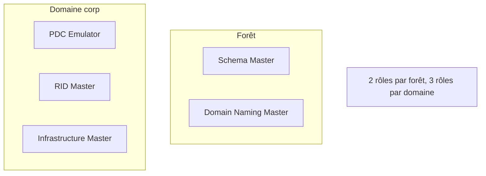

# Fiche — Rôles FSMO

> Volet académique. Certaines opérations AD ne tolèrent pas le multi-maître : elles sont confiées
> à des **rôles à maître unique (FSMO)**. Les connaître = savoir diagnostiquer et récupérer.

## 1. Rôle & utilité
AD est multi-maître, mais 5 opérations doivent être pilotées par **un seul** DC à la fois pour
éviter les conflits. Ce sont les **FSMO** (Flexible Single Master Operations).

## 2. Les 5 rôles
| Rôle | Portée | Fonction |
|---|---|---|
| **Schema Master** | Forêt | Seul à pouvoir modifier le schéma |
| **Domain Naming Master** | Forêt | Ajout/suppression de domaines, partitions |
| **PDC Emulator** | Domaine | Source de temps, traitement prioritaire des mots de passe, verrouillages, GPO (éditeur par défaut) |
| **RID Master** | Domaine | Distribue les pools de RID (pour fabriquer les SID) |
| **Infrastructure Master** | Domaine | Maintient les références inter-domaines (phantoms) |

## 3. Points clés par rôle
- **PDC Emulator** : le plus « sensible » au quotidien (temps NTP de référence, W32time ; mauvaises
  tentatives de mot de passe vérifiées auprès de lui ; cible par défaut des outils GPO).
- **RID Master** : si indisponible longtemps, plus de création d'objets une fois le pool épuisé.
- **Infrastructure Master** : ne pas placer sur un GC si environnement multi-domaines sans "tous GC"
  (sinon références inter-domaines non maintenues) — nuance classique d'examen.

## 4. Transfert vs saisie (seizure)
- **Transfert** : déplacement **propre** d'un rôle vers un autre DC (les deux DC sont en ligne).
- **Saisie (seize)** : prise **forcée** quand le détenteur est **définitivement** mort. Le DC
  saisi ne doit **jamais** revenir en ligne (risque de duplication) → le nettoyer (metadata cleanup).

## 5. Implémentation Windows
- `netdom query fsmo`, `Get-ADDomain`/`Get-ADForest` (propriétés …Master), `Move-ADDirectoryServerOperationMasterRole`
  (transfert et, avec `-Force`, saisie), `ntdsutil` (roles, metadata cleanup).

## 6. Objets & attributs liés
- Les rôles sont des attributs `fSMORoleOwner` sur les objets de partition correspondants.

## 7. Surface d'attaque (aperçu)
- Le **PDC Emulator** est une cible privilégiée (temps, mots de passe, GPO). Compromis = levier fort.
- **DCShadow** exploite des mécanismes proches de la réplication (module 26).

## 8. Détection (aperçu)
Transferts/saisies de rôles FSMO (événements Directory Service), changements inattendus de
détenteur. Voir `defend.md`.

## 9. Versioning
Stable. Les bonnes pratiques de placement (PDC/RID ensemble, Schema/DNM sur un DC de forêt) perdurent.

## 10. Pour aller plus loin
Microsoft Learn — FSMO roles ; *Mastering AD*. Voir `99-ressources/bibliographie.md` (P2).
