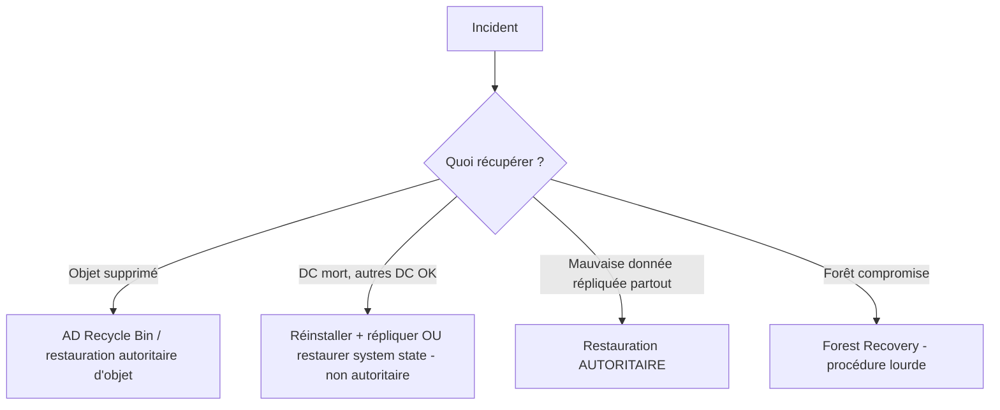

# Fiche — Sauvegarde & PRA d'Active Directory

> Volet académique. Savoir **restaurer** AD est aussi important que savoir le construire. Un DC
> mort, une suppression accidentelle ou un rançongiciel se gèrent par des procédures précises.

## 1. Rôle & utilité
La sauvegarde/PRA (Plan de Reprise d'Activité) garantit qu'on peut **récupérer** l'annuaire :
objet supprimé, DC défaillant, voire **forêt** compromise. C'est la dernière ligne de défense.

## 2. Ce qu'on sauvegarde
- **System State** d'un DC : inclut NTDS.dit, SYSVOL, registre, etc. (sauvegarde de référence pour AD).
- **Au moins 2 DC** sauvegardés, régulièrement, avec rétention < **tombstone lifetime** (180 j par défaut).

## 3. Types de restauration

- **Non autoritaire** : le DC restauré se remet à jour depuis les autres (cas normal d'un DC mort).
- **Autoritaire** (ntdsutil) : on **impose** des objets/sous-arbres restaurés comme "vérité" (ex.
  réintroduire une OU supprimée et la faire gagner sur la réplication).
- **AD Recycle Bin** : restaure des objets supprimés **sans redémarrer** en DSRM (recommandé, à activer).
- **Forest Recovery** : procédure Microsoft lourde en cas de compromission totale (krbtgt x2, etc.).

## 4. Concepts clés
- **DSRM (Directory Services Restore Mode)** : mode de maintenance hors-ligne (mot de passe DSRM).
- **Tombstone / Deleted Objects** : objets supprimés conservés un temps (base de la Recycle Bin).
- **Metadata cleanup** : retirer proprement un DC mort de l'annuaire (après saisie FSMO, module 28).
- **BMR (Bare Metal Recovery)** : restauration complète d'un serveur.

## 5. Implémentation Windows
- **Windows Server Backup** (`wbadmin`), Proxmox Backup Server (niveau VM), `ntdsutil`
  (authoritative restore), `Enable-ADOptionalFeature` (Recycle Bin), `Get-ADObject -IncludeDeletedObjects`.

## 6. Objets & attributs liés
- Conteneur **Deleted Objects** ; attribut `isDeleted`, `lastKnownParent`.

## 7. Surface d'attaque (aperçu)
- **Rançongiciel** ciblant les DC/sauvegardes → d'où sauvegardes **hors-ligne/immuables**.
- **Suppression massive** d'objets (DoS) → Recycle Bin + restauration autoritaire.
- Une **restauration de krbtgt** mal maîtrisée peut réintroduire des secrets compromis.

## 8. Détection (aperçu)
Suppressions massives d'objets (5141), restaurations, démarrages en DSRM. Voir `defend.md`.

## 9. Versioning
AD Recycle Bin (2008 R2+, irréversible une fois activée). Forest Recovery documenté par Microsoft ;
intégration croissante avec des solutions tierces (Semperis, etc.).

## 10. Pour aller plus loin
Microsoft Learn — AD Backup and Recovery / Forest Recovery Guide. Voir `bibliographie.md` (P2, P7).
