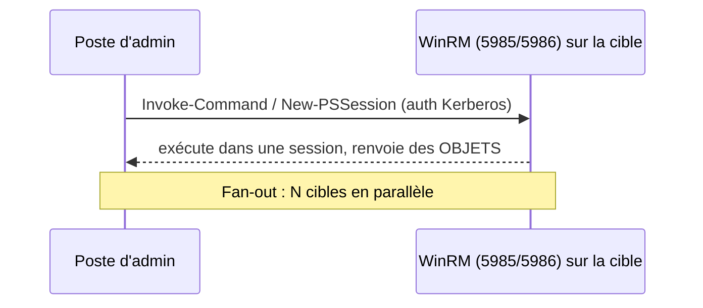

# Fiche — PowerShell Remoting (gérer à distance et à l'échelle)

> Volet académique. Le remoting permet d'exécuter des commandes sur **des dizaines/centaines** de
> machines à la fois — brique essentielle de l'administration automatisée de CORP.

## 1. Rôle & utilité
PowerShell Remoting exécute des commandes/scripts sur des machines distantes via **WinRM** (ou SSH
pour PS7). Il remplace les connexions RDP manuelles et permet l'action **en parallèle** sur un parc.

## 2. Fonctionnement

- **Transport** : WinRM sur **5985** (HTTP) / **5986** (HTTPS) ; ou **SSH** (PS7, multiplateforme).
- **Authentification** : Kerberos par défaut dans le domaine (pas de mot de passe sur le réseau).
- **Cmdlets** : `Enter-PSSession` (interactif), `Invoke-Command` (ponctuel/fan-out),
  `New-PSSession` (sessions persistantes réutilisables).

## 3. Concepts clés
- **Fan-out** : `Invoke-Command -ComputerName A,B,C { ... }` exécute en parallèle (throttle réglable).
- **Sessions persistantes** : `$s = New-PSSession ...; Invoke-Command -Session $s { }` (plus efficace).
- **Double-hop** : par défaut, un credential ne se "propage" pas sur un 2e saut (sécurité) ;
  solutions : **Kerberos delegation contrainte**, **CredSSP** (risqué), ou **resource-based**.
- **JEA (Just Enough Administration)** : endpoints restreints exposant seulement certaines commandes
  à certains utilisateurs → délégation sans droits d'admin complets.
- **Sessions de configuration** (`Register-PSSessionConfiguration`) pour JEA.

## 4. Implémentation Windows
- Activation : `Enable-PSRemoting` (ou GPO WinRM à l'échelle). Fichier `TrustedHosts` hors domaine.
- Pare-feu : règles WinRM. HTTPS requiert un certificat.
- Module : cmdlets intégrées (`*-PSSession`, `Invoke-Command`).

## 5. Objets & attributs liés
- WinRM listeners, `Enable-PSRemoting` (service WinRM en auto), endpoints de session.

## 6. Surface d'attaque (aperçu)
- **WinRM = mouvement latéral** (T1021.006) : un credential volé permet l'exécution à distance.
- **CredSSP** expose les credentials sur la cible (à éviter).
- **WinRM exposé** largement = surface d'attaque ; d'où segmentation + JEA.

## 7. Détection (aperçu)
Connexions WinRM (4624 logon type 3 vers wsmprovhost), création de `wsmprovhost.exe`, usage
inhabituel d'Invoke-Command. Voir `defend.md`.

## 8. Versioning
PS7 ajoute le remoting **SSH** (multiplateforme). JEA disponible depuis WMF 5.

## 9. Pour aller plus loin
*Mastering PowerShell Scripting* (remoting, JEA). Voir `99-ressources/bibliographie.md` (P3).
