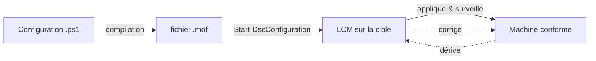

# Fiche — DSC (Desired State Configuration)

> Volet académique. DSC décrit l'état **voulu** d'une machine (rôles, services, réglages) de façon
> **déclarative** ; Windows s'occupe d'y conformer la machine et de corriger les dérives.

## 1. Rôle & utilité
Au lieu de scripter "comment faire" (impératif), DSC déclare "ce qui doit être vrai" (déclaratif) :
"le rôle DNS est installé", "ce service tourne", "cette clé de registre vaut X". DSC applique et
**maintient** cet état → fin de la dérive de configuration.

## 2. Fonctionnement

- **Configuration** : bloc PowerShell déclaratif utilisant des **ressources DSC**.
- **Ressources DSC** : briques (`WindowsFeature`, `Service`, `Registry`, `File`, modules comme
  `ActiveDirectoryDsc`, `NetworkingDsc`, `xDnsServer`…).
- **MOF** : fichier compilé décrivant l'état voulu, poussé vers la cible.
- **LCM (Local Configuration Manager)** : agent sur la cible qui applique/surveille (modes
  `ApplyOnly`, `ApplyAndMonitor`, `ApplyAndAutoCorrect`).

## 3. Modèles de distribution
- **Push** : l'admin pousse le MOF (`Start-DscConfiguration`). Simple, bon pour le lab.
- **Pull** : les cibles récupèrent leur config depuis un serveur Pull (scalable).
- **Azure Automation / Machine Configuration** : DSC géré côté cloud (évolution moderne).

## 4. DSC v1 (5.1) vs v3
- **DSC 1.1** (PS 5.1) : historique, intégré, riche en ressources communautaires.
- **DSC v3** : refonte multiplateforme (PS7), basée sur des ressources en divers langages. Choisir
  selon l'écosystème ; beaucoup de ressources AD historiques ciblent 5.1.

## 5. Ressources utiles pour AD
`ActiveDirectoryDsc` (forêt, domaine, OU, users, groupes), `xDnsServer`, `NetworkingDsc`,
`ComputerManagementDsc`, `GroupPolicyDsc`/`SecurityPolicyDsc` (droits utilisateur → utile pour le
deny-logon du tiering, module 22).

## 6. Idempotence native
DSC est idempotent **par conception** : `Test-DscConfiguration` compare l'état réel à l'état voulu ;
l'application ne change que ce qui diffère.

## 7. Surface d'attaque (aperçu)
- Un **MOF/Pull server** compromis = configuration malveillante distribuée à grande échelle.
- Secrets dans les configurations → utiliser des **certificats de chiffrement** (jamais en clair).

## 8. Détection (aperçu)
Changements de configuration DSC, échecs/corrections du LCM, modifications du MOF. Voir `defend.md`.

## 9. Versioning
Transition 5.1 → v3 en cours ; côté cloud, Azure Machine Configuration. Pour un lab AD Windows,
`ActiveDirectoryDsc` sur 5.1 reste très courant.

## 10. Pour aller plus loin
Microsoft Learn — DSC ; PowerShell Gallery (ActiveDirectoryDsc). Voir `bibliographie.md` (P3).
