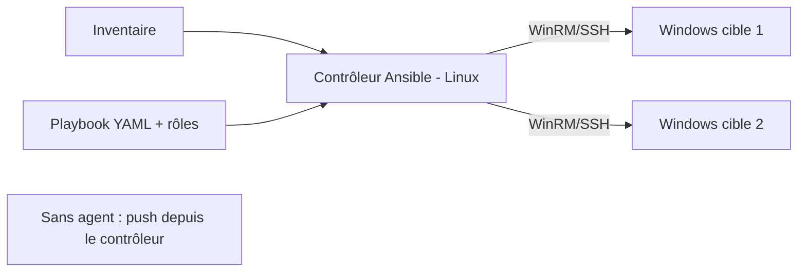

# Fiche — Ansible pour Windows

> Volet académique. Ansible orchestre la configuration de **parcs hétérogènes** depuis un contrôleur
> Linux, sans agent. Pour CORP, c'est l'outil qui configure les VM Windows après leur création.

## 1. Rôle & utilité
Ansible applique des **playbooks** (YAML déclaratif) décrivant l'état voulu de machines. Contrôleur
sous Linux (ex. ton poste d'attaque/admin), cibles Windows pilotées via **WinRM** (ou SSH).
C'est l'outil de prédilection pour configurer GOAD/CORP de façon reproductible.

## 2. Fonctionnement

- **Inventaire** : liste des hôtes + variables (statique INI/YAML ou dynamique).
- **Playbook** : suite de *tasks* (idempotentes) regroupées en *plays*/*roles*.
- **Modules** : via les collections `ansible.windows`, `community.windows`,
  `microsoft.ad` (gestion AD : domaine, users, groupes, OU…).
- **Connexion Windows** : `ansible_connection=winrm` (ou `psrp`), auth Kerberos/NTLM/credssp.

## 3. Concepts clés
- **Idempotence** : les modules n'agissent que si l'état diffère (comme DSC).
- **Rôles** : unités réutilisables (tasks/handlers/templates/vars) → structurer CORP en rôles
  (`dc`, `fileserver`, `member`…).
- **Variables & templates (Jinja2)** : paramétrer par site/tier.
- **Ansible Vault** : chiffrer les secrets (jamais en clair dans le dépôt).
- **Collections** : `microsoft.ad` (promotion DC `microsoft.ad.domain`, `microsoft.ad.user`…),
  `ansible.windows` (`win_feature`, `win_service`, `win_regedit`, `win_dsc` pour réutiliser DSC).

## 4. Ansible vs DSC
- **DSC** : agent local, anti-dérive continue, natif Windows.
- **Ansible** : orchestration multi-nœuds depuis Linux, sans agent, idéal pour **séquencer** un
  déploiement complet (créer le DC, puis les membres, puis les objets).
- Les deux se combinent (`win_dsc` applique une ressource DSC depuis Ansible).

## 5. Implémentation
- Contrôleur Linux : `pip install ansible pywinrm`. Collections :
  `ansible-galaxy collection install microsoft.ad ansible.windows community.windows`.
- Cibles : WinRM activé (module 31), auth (Kerberos recommandé via `kinit`).

## 6. Surface d'attaque (aperçu)
- Le **contrôleur Ansible** et son **Vault**/inventaire = cibles sensibles (clés du parc).
- WinRM/CredSSP exposés (voir module 31).

## 7. Détection (aperçu)
Connexions WinRM massives depuis le contrôleur, exécutions distantes (wsmprovhost), changements de
config. Voir `defend.md`.

## 8. Versioning
Collections Windows en évolution rapide ; `microsoft.ad` a modernisé la gestion AD. Vérifier les
versions de collections.

## 9. Pour aller plus loin
Docs Ansible (Windows guides), collection `microsoft.ad`. Voir `99-ressources/bibliographie.md` (P3).
