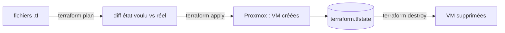

# Fiche — Terraform : Infrastructure as Code sur Proxmox

> Volet académique. Terraform **provisionne** les VM (l'infrastructure) de façon déclarative. Dans
> CORP : Terraform crée les VM sur Proxmox, Ansible/DSC les configure ensuite.

## 1. Rôle & utilité
Terraform décrit l'infrastructure (VM, réseaux, disques) dans des fichiers `.tf` déclaratifs, et la
crée/modifie/détruit via les **providers**. Il maintient un **state** qui reflète le réel → on gère
l'infra comme du code (versionné, revu, reproductible).

## 2. Fonctionnement

- **Provider** : plugin vers une plateforme (ici `bpg/proxmox`).
- **Resource** : un objet géré (`proxmox_virtual_environment_vm`).
- **State** (`terraform.tfstate`) : la carte de ce que Terraform gère (NE PAS committer — secrets).
- **Plan/Apply/Destroy** : prévoir, appliquer, détruire.
- **Variables** (`variables.tf`, `*.tfvars`) et **outputs**.
- **Modules** : regrouper des resources réutilisables (ex. un module "windows-vm").

## 3. Terraform vs Ansible/DSC (complémentaires)
- **Terraform** : *provisioning* de l'infra (créer la VM, le disque, la carte réseau/VLAN).
- **Ansible/DSC** : *configuration* de l'OS/appli une fois la VM là.
- Pipeline CORP : **Terraform crée** → **cloud-init/Ansible configure** → **DSC maintient**.

## 4. Concepts clés
- **Idempotence via state** : `apply` ne change que le diff.
- **cloud-init** : personnalisation initiale de la VM (hostname, IP, utilisateur) au 1er boot.
- **Templates** : cloner depuis un template Packer (module Phase 0).
- **Secrets** : jamais en clair ; variables sensibles, state protégé/chiffré.

## 5. Implémentation (Proxmox)
- Provider `bpg/proxmox`, authentification par **token API** Proxmox.
- Réseau : `vlan_id` par zone (architecture.md §12). Disque sur le datastore voulu.

## 6. Surface d'attaque (aperçu)
- **State** et **token API** = secrets critiques (accès à toute l'infra).
- Un pipeline IaC compromis peut provisionner des VM malveillantes.

## 7. Détection (aperçu)
Actions d'API Proxmox inhabituelles, modifications de state, création/destruction de VM non planifiée.
Voir `defend.md`.

## 8. Versioning
Épingler les versions de provider (`~>`). Pour le travail en équipe : **remote state** (backend) +
verrouillage.

## 9. Pour aller plus loin
Docs Terraform ; provider `bpg/proxmox` ; Ludus (alternative "range as code"). Voir `bibliographie.md` (P0, P3).
