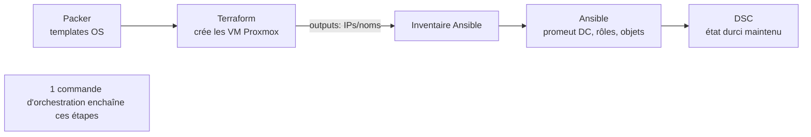

# Fiche — Déployer tout CORP « en une commande »

> Volet académique & synthèse. On assemble Terraform + Ansible + DSC (+ cloud-init/Packer) en un
> **pipeline unique** qui reconstruit l'intégralité de CORP de zéro. C'est l'aboutissement de la
> Phase 3 : l'infrastructure et la configuration deviennent **du code reproductible**.

## 1. Objectif
Pouvoir **détruire et recréer** CORP à volonté, à l'identique, par un seul point d'entrée. Avantage :
on expérimente sans peur (snapshots + rebuild), on documente l'infra *par le code*, et on applique
la même rigueur qu'en production.

## 2. Architecture du pipeline

- **Packer** (Phase 0) : fabrique les templates Windows/Linux versionnés.
- **Terraform** (module 34) : provisionne les VM selon `architecture.md` (sites/VLAN/tiers).
- **Ansible** (module 33) : promeut le premier DC, les DC additionnels, crée OU/users/groupes,
  applique GPO/LAPS/DFS…
- **DSC** (module 32) : maintient l'état durci (anti-dérive).

## 3. Séquencement (le point délicat)
L'ordre compte : on ne configure un membre que lorsque le DC répond.
1. Terraform crée **PAR-DC-01** → Ansible le **promeut** (forêt `corp.meridian.com`).
2. Terraform crée les **autres DC/membres** → Ansible les **joint** au domaine.
3. Ansible applique la **structure** (OU, groupes AGDLP, tiering, GPO, LAPS, DFS).
4. DSC prend le relais pour l'**anti-dérive**.
On gère les dépendances (Terraform `depends_on`, `wait_for_connection` Ansible, retries).

## 4. Idempotence de bout en bout
Chaque couche est idempotente : relancer le pipeline converge vers l'état voulu sans tout recréer.
`terraform destroy` + `apply` = reconstruction complète ; un simple `apply`/playbook = mise à jour.

## 5. Gestion des secrets (critique)
- **Ansible Vault** pour les mots de passe (DSRM, comptes) ; **jamais** en clair.
- **Token API Proxmox** et **tfstate** hors dépôt (.gitignore) ; idéalement remote state chiffré.
- Mots de passe initiaux forts, rotation (LAPS pour le local).

## 6. Deux approches possibles
- **Sur-mesure** : Terraform + Ansible + DSC maison (ce module) → contrôle total, pédagogique.
- **Ludus** (Phase 0) : « range as code » qui orchestre déjà Packer/Terraform/Ansible sur Proxmox,
  et sait déployer GOAD. Idéal pour GOAD-X ; CORP peut aussi s'y décrire.

## 7. Surface d'attaque (synthèse)
Le **pipeline = Tier 0** : qui le contrôle contrôle tout CORP. Secrets (Vault/token/state), contrôleur
d'orchestration, templates → tous critiques (cumul des modules 32-34).

## 8. Détection (synthèse)
Création/destruction massive de VM, exécutions de masse (WinRM), changements de config — corréler
dans le SIEM (Phase 7).

## 9. Versioning
Épingler toutes les versions (provider, collections, ressources DSC) pour un rebuild reproductible
dans le temps.

## 10. Pour aller plus loin
Docs Terraform/Ansible/DSC ; Ludus. *Mastering PowerShell Scripting*. Voir `bibliographie.md` (P0, P3).
