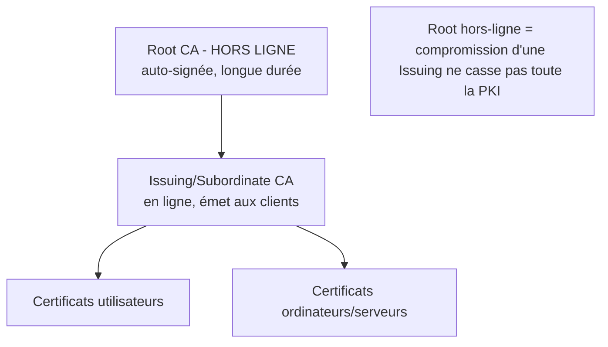

# Fiche — Conception d'une PKI (AD CS)

> Volet académique. Avant de déployer AD CS, il faut **concevoir** la PKI : hiérarchie, usages,
> durées, révocation. Une PKI mal conçue = dette de sécurité durable (et base des attaques ESC).

## 1. Rôle & utilité
Une **PKI (Public Key Infrastructure)** émet et gère des **certificats** (paires clé publique/privée
liées à une identité). Dans AD, **AD CS** fournit l'authentification forte (smartcard, Wi-Fi/802.1X,
VPN), le chiffrement (TLS interne, S/MIME), la signature, et l'**authentification par certificat**
(PKINIT/Kerberos). Les certificats sont une identité à part entière → donc une **surface d'attaque**.

## 2. Hiérarchie recommandée (2 niveaux)

- **Root CA** : racine de confiance, **auto-signée**, **hors-ligne** (éteinte/déconnectée), longue
  validité (ex. 10-20 ans). Ne signe QUE les CA subordonnées.
- **Issuing CA (subordonnée)** : en ligne, **Enterprise CA** intégrée à AD, émet les certificats
  aux utilisateurs/machines. Durée plus courte.
- 1 niveau (Enterprise Root CA seule) possible en lab mais moins sûr ; 3 niveaux pour grandes orgs.

## 3. Standalone vs Enterprise
- **Enterprise CA** : intégrée à AD (templates, auto-enrollment, publication dans l'annuaire).
  L'Issuing CA de CORP est Enterprise.
- **Standalone CA** : hors annuaire (souvent la Root hors-ligne).

## 4. Éléments de conception
- **Algorithmes/longueurs** : RSA 3072/4096 ou ECC ; hash SHA-256+.
- **Durées** : Root > Issuing > certificats feuilles.
- **Révocation** : **CRL** (liste de révocation) + **points de distribution (CDP)** et **AIA**
  (accès aux certificats de l'autorité) accessibles (souvent via HTTP). **OCSP** pour la révocation
  en temps réel.
- **CAPolicy.inf** : fichier qui cadre l'installation des CA (contraintes, durées, CPS).
- **Key protection** : clés de CA protégées (idéalement **HSM** en prod).

## 5. Rôle dans l'authentification
- **Certificate Mapping** : un certificat est lié à un compte AD (implicite via UPN/SAN, ou explicite
  via `altSecurityIdentities`). Les abus de mapping sont au cœur de plusieurs ESC et du durcissement
  2022/2023 (KB5014754, OID de mapping fort).
- **PKINIT** : authentification Kerberos par certificat.

## 6. Objets & attributs AD liés
- Conteneurs **Public Key Services** (`CN=...,CN=Public Key Services,CN=Services,CN=Configuration`) :
  `Certification Authorities`, `Enrollment Services`, `Certificate Templates`, `NTAuthCertificates`.
- `NTAuthCertificates` : les CA autorisées à émettre des certificats d'**authentification** (critique).

## 7. Surface d'attaque (aperçu, détaillé module 43)
Une PKI est une cible majeure : les familles **ESC1→ESC16** exploitent des templates/permissions/
mappings mal configurés pour obtenir une **authentification en tant que n'importe qui** (y compris
Domain Admin). La conception (durées, mapping, révocation, séparation des rôles) conditionne le risque.

## 8. Détection (aperçu)
Émissions de certificats sensibles, modifications de templates/CA, ajouts à NTAuth. Voir modules 42-43.

## 9. Versioning
Durcissements majeurs 2022-2023 (mapping fort, KB5014754) ; AD CS reste très présent. Alternative
cloud : services de certificats Entra/Intune (hors scope ici).

## 10. Pour aller plus loin
*Certified Pre-Owned* (SpecterOps), Microsoft Learn — AD CS design. Voir `bibliographie.md` (P4).
