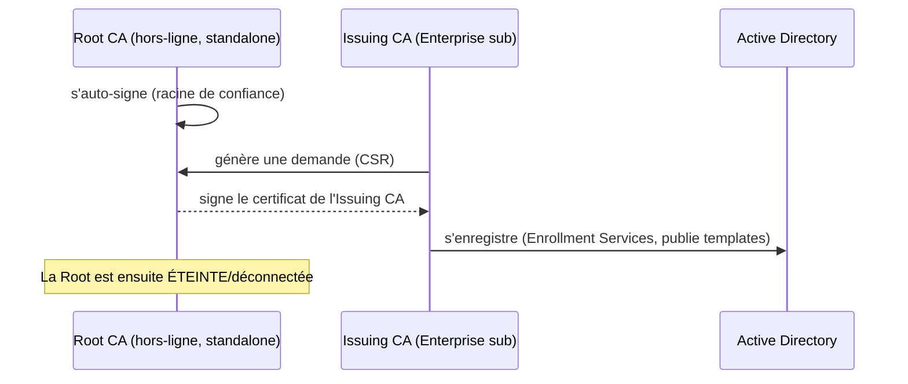

# Fiche — Déploiement d'AD CS (Root hors-ligne + Issuing)

> Volet académique. On met en œuvre la conception du module 40 : installer la Root CA hors-ligne,
> puis l'Issuing CA Enterprise, avec révocation et audit.

## 1. Rôle & utilité
AD CS (Active Directory Certificate Services) est le rôle Windows qui **héberge les CA** et émet les
certificats. Le déploiement correct (root hors-ligne, CDP/AIA, audit) conditionne toute la sécurité.

## 2. Composants du rôle AD CS
- **Certification Authority (CA)** : le service d'émission.
- **CA Web Enrollment** : enrôlement via navigateur (ATTENTION : vecteur **ESC8** si NTLM/relais —
  à ne pas exposer sans durcissement).
- **CES/CEP (Enrollment Policy/Web Services)** : enrôlement via HTTPS (pour hors-domaine).
- **NDES** : enrôlement d'appareils (SCEP) — surface d'attaque spécifique.
- **OCSP (Online Responder)** : révocation en temps réel.

## 3. Processus de déploiement (2 niveaux)

## 4. Révocation & publication
- Configurer **CDP/AIA** (souvent HTTP) accessibles ; publier la **CRL** de la root manuellement
  (puisqu'elle est hors-ligne) à intervalle régulier.
- **OCSP** si révocation temps réel voulue.

## 5. Implémentation Windows
- Rôle : `Install-WindowsFeature ADCS-Cert-Authority`. Configuration :
  `Install-AdcsCertificationAuthority` (type `StandaloneRootCA` puis `EnterpriseSubordinateCA`).
- `certutil` pour la gestion/diagnostic ; console **certsrv.msc**.

## 6. Objets & attributs AD liés
- Publication dans **Public Key Services** (Enrollment Services, AIA, CDP, NTAuthCertificates).

## 7. Surface d'attaque (aperçu, détail module 43)
- **ESC8** : CA Web Enrollment (HTTP) + relais NTLM → certificat d'un compte machine/DC.
- **ESC11** : interface RPC d'enrôlement sans signature.
- **ESC7** : permissions de gestion de la CA (ManageCA/ManageCertificates) mal attribuées.
- CA en ligne mal protégée = Tier 0 compromis.

## 8. Détection (aperçu)
Activer l'**audit AD CS** (émission, modif de CA/template) : events 4886-4899 (Certification
Services). Voir modules 42-43.

## 9. Versioning
Durcissements 2022-2023 (mapping fort). NDES/Web Enrollment à éviter/durcir.

## 10. Pour aller plus loin
Microsoft Learn — Deploy AD CS ; *Certified Pre-Owned*. Voir `99-ressources/bibliographie.md` (P4).
