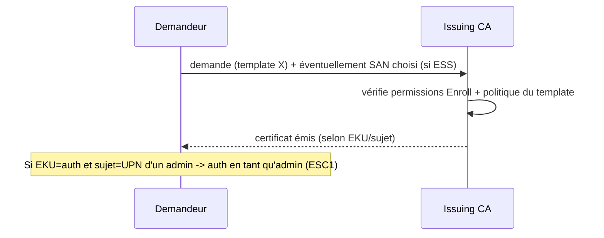

# Fiche — Templates de certificats & enrôlement

> Volet académique. Les **templates** définissent QUI peut obtenir QUEL certificat, pour QUEL usage,
> et COMMENT. Ils sont au cœur des attaques ESC1-ESC3/ESC9-ESC10 : leur configuration fait tout.

## 1. Rôle & utilité
Un **certificate template** est un modèle stocké dans AD qui décrit un type de certificat :
usages (EKU), sujet, durée, permissions d'enrôlement, méthode d'approbation. L'Issuing CA émet selon
ces templates. Une case mal cochée = escalade de privilèges (voir module 43).

## 2. Paramètres critiques (à comprendre absolument)
- **EKU (Enhanced Key Usage)** : à quoi sert le cert. Dangereux : **Client Authentication**,
  **PKINIT Client Authentication**, **Smart Card Logon**, **Any Purpose**, ou **pas d'EKU** →
  certificat utilisable pour s'**authentifier**.
- **Subject Name** :
  - *Build from AD* (sûr) : la CA fixe le sujet depuis l'annuaire.
  - **ENROLLEE_SUPPLIES_SUBJECT (ESS)** : le demandeur **choisit** le sujet/SAN → il peut demander
    un cert « pour quelqu'un d'autre » = **ESC1** si combiné à une EKU d'auth + enrôlement ouvert.
- **Permissions (ACL du template)** : qui peut **Enroll**/**AutoEnroll**, et qui peut **écrire** le
  template (Write → ESC4).
- **Manager approval** : si requis, l'émission n'est pas automatique (atténuation).
- **Authorized signatures** : exige une co-signature (atténuation).
- **Auto-enrollment** : émission automatique via GPO (pratique mais à cadrer).

## 3. Enrôlement

- **Modes** : auto-enrollment (GPO), manuel (certmgr/MMC), web (`certsrv`), CES/CEP, `certreq`.

## 4. Implémentation Windows
- Console **certtmpl.msc** (templates), **certsrv.msc** (publier un template sur la CA).
- PowerShell : module `PSPKI` (communauté) ou `certutil` ; auto-enrollment via GPO.

## 5. Objets & attributs AD liés
- `pKICertificateTemplate` sous `CN=Certificate Templates,CN=Public Key Services,...`.
- Attributs : `msPKI-Certificate-Name-Flag` (ESS), `pKIExtendedKeyUsage` (EKU),
  `msPKI-Enrollment-Flag`, `msPKI-RA-Signature`, et l'**ACL** du template.

## 6. Surface d'attaque (aperçu, détail module 43)
- **ESC1** : ESS + EKU d'auth + Enroll ouvert → cert pour n'importe quel UPN.
- **ESC2** : EKU Any Purpose / SubCA.
- **ESC3** : Enrollment Agent.
- **ESC4** : droits d'**écriture** sur un template (le rendre vulnérable).
- **ESC9/ESC10** : faiblesses de mapping (no security extension / weak mapping).

## 7. Détection (aperçu)
Émission avec SAN inhabituel, modifications de templates (5136), publication de templates. Voir `defend.md`.

## 8. Versioning
Templates v1→v4 ; durcissements 2022-2023 (security extension szOID, mapping fort). Outils d'audit :
**Certify**, **Certipy**, **PSPKI**, **Locksmith** (défensif).

## 9. Pour aller plus loin
*Certified Pre-Owned* ; Certipy/Certify wikis. Voir `99-ressources/bibliographie.md` (P4).
