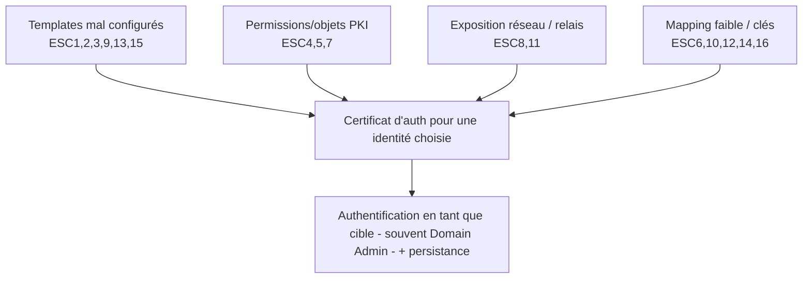

# Fiche — Attaques AD CS : la famille ESC (ESC1 → ESC16)

> Volet académique. Panorama structuré des mauvaises configurations AD CS (« ESC ») popularisées par
> *Certified Pre-Owned* (SpecterOps) et étendues depuis. Chaque ESC = un chemin d'escalade/persistance
> par certificat. Ce module est aussi relié à `04-solutions/` (améliorations GOAD).

## 1. Pourquoi les certificats sont si dangereux
Un certificat d'authentification = une **identité** utilisable sans mot de passe, souvent **longtemps**
(jusqu'à expiration/révocation) et **résistant** à un changement de mot de passe → outil d'escalade
ET de **persistance** furtive.

## 2. Catalogue ESC (vue d'ensemble)
| ESC | Idée | Cible du durcissement |
|---|---|---|
| **ESC1** | Template : SAN libre (ESS) + EKU d'auth + Enroll large | Subject Build-from-AD, Enroll ciblé |
| **ESC2** | Template EKU Any Purpose / SubCA | restreindre EKU |
| **ESC3** | Enrollment Agent (demander "au nom de") | limiter l'agent, approval |
| **ESC4** | Droit **Write** sur un template (le rendre vuln.) | ACL templates (Tier 0) |
| **ESC5** | Droits sur objets PKI (CA object, NTAuth, OIDs…) | ACL Public Key Services |
| **ESC6** | Flag `EDITF_ATTRIBUTESUBJECTALTNAME2` sur la CA | retirer le flag |
| **ESC7** | Droits **ManageCA/ManageCertificates** | ACL de la CA |
| **ESC8** | Web Enrollment HTTP + **relais NTLM** | HTTPS+EPA, no NTLM |
| **ESC9** | `CT_FLAG_NO_SECURITY_EXTENSION` (no szOID) | mapping fort |
| **ESC10** | Weak certificate mapping (clé registre) | StrongCertificateBinding |
| **ESC11** | RPC enrôlement sans signature (relais) | IF_ENFORCEENCRYPTICERTREQUEST |
| **ESC12** | Clés CA exposées (ex. YubiHSM shell) | protection des clés |
| **ESC13** | OID de groupe d'émission → droits via issuance policy | revue des policies |
| **ESC14** | Weak explicit mapping (`altSecurityIdentities`) | mapping explicite fort |
| **ESC15** | EKUwu : app policies v1 + SAN (CVE-2024-...) | patch + templates v1 |
| **ESC16** | Security extension désactivée côté CA / mapping | config CA + mapping fort |

> Les numéros ESC évoluent (la communauté en ajoute). L'essentiel : **templates**, **permissions**
> (CA/objets), **mapping**, **exposition réseau (relais)**, **protection des clés**.

## 3. Les quatre grandes familles

## 4. Chaîne type (ex. ESC1)
Enumération (Certipy `find`) → demande de cert avec SAN d'un admin → `certipy auth` (PKINIT) → TGT
de l'admin → DCSync/contrôle du domaine.

## 5. Outils
- **Offensif** : Certipy (Linux), Certify + Rubeus (Windows), PetitPotam/Coercer (ESC8).
- **Défensif** : Certipy `find`, PSPKI, **Locksmith**, PingCastle/Purple Knight, audit AD CS.

## 6. Détection (transversale)
Événements AD CS 4886/4887 (émission), 4899/4890 (changement de config CA), 5136 (templates/objets
PKI), corrélation SAN≠requester, certificats d'auth pour comptes machines (ESC8). Voir `defend.md`.

## 7. Versioning / mitigations majeures
- **KB5014754 (2022-2023)** : mapping fort (certificate binding), security extension szOID → ferme
  ESC9/ESC10 et renforce le mapping. Appliquer les patchs et passer en mode "Full enforcement".
- Des ESC récents (ESC15/EKUwu) sont corrigés par patch → **patcher** la CA.

## 8. Pour aller plus loin
*Certified Pre-Owned* (whitepaper), Certipy wiki, SpecterOps. Voir `99-ressources/bibliographie.md` (P4).
