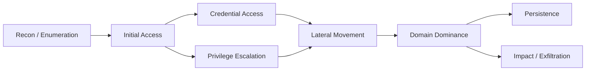

# Fiche — Méthodologie de pentest Active Directory

> Volet académique. Avant les techniques, le **cadre** : comment aborder une compromission AD de
> façon structurée, éthique et traçable. S'applique dans GOAD-X (lab isolé).

## 1. Rôle & utilité
Une méthodologie évite de « tirer dans tous les sens » : elle structure l'effort, maximise les
chances, et surtout rend le travail **reproductible et documenté** (essentiel pour la partie
solution/détection du workbook).

## 2. Le cycle d'une intrusion AD

- **Recon/Enum** (module 51) : cartographier users, groupes, ACL, délégations, PKI, partages.
- **Initial access** : un premier credential (spray, phishing simulé, service exposé).
- **Credential access / escalation** : Kerberoasting (52), ACL (21), ESC (43), coercition (54).
- **Lateral movement** : PtH/PtT, WinRM, délégations (53).
- **Domain dominance** : DCSync, contrôle du Tier 0.
- **Persistence** (57) : Golden/Silver/Diamond, certificats, ACL.

## 3. Cadres de référence
- **MITRE ATT&CK** : tactiques (colonnes) × techniques (cellules). On **mappe** chaque action.
- **Cyber Kill Chain**, **Unified Kill Chain** : vues complémentaires.
- **PTES / OWASP / OSSTMM** : méthodologies de test générales.

## 4. Posture « assumed breach »
Beaucoup d'évaluations AD partent d'un **compte standard déjà obtenu** (assumed breach) pour se
concentrer sur l'escalade interne — c'est le mode par défaut dans GOAD/CORP.

## 5. Outils (panorama, détaillés dans les modules suivants)
- **Recon** : BloodHound/SharpHound, PowerView, ldapsearch, NetExec, enum4linux-ng.
- **Kerberos** : Rubeus, impacket (GetUserSPNs, getTGT…), Kerbrute.
- **Creds** : Mimikatz, impacket secretsdump, Certipy.
- **Relais/coercition** : Responder, ntlmrelayx, PetitPotam/Coercer.
- **Orchestration** : NetExec (ex-CrackMapExec).

## 6. Traçabilité & reporting (compétence d'expert)
- **Journal de bord** : horodater chaque action (utile pour la détection/blue team et le rapport).
- **Rapport** : contexte, chemin d'attaque, preuves, impact, **remédiation**. Templates fournis
  (ce module, dossier `automate/`).
- **OPSEC** (en lab, pédagogique) : comprendre ce qui est bruyant vs furtif → éclaire la détection.

## 7. Éthique & périmètre
- **Autorisation écrite** obligatoire hors lab ; ici **GOAD-X isolé uniquement** (LEGAL.md).
- Ne jamais rejouer ces techniques sur un système tiers.

## 8. Lien détection (purple)
Chaque technique des modules 51-58 a un volet **defend.md** : la méthodologie relie l'attaque à sa
détection (ATT&CK → data source → règle Sigma).

## 9. Pour aller plus loin
*Pentesting AD and Windows Infrastructure*, *The Hacker Playbook 3*, The Hacker Recipes.
Voir `99-ressources/bibliographie.md` (P5).
