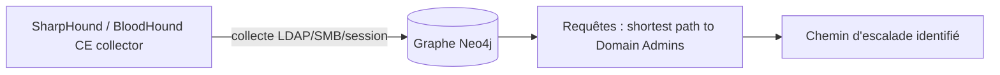

# Fiche — Reconnaissance & énumération AD

> Volet académique. La recon est la phase la plus rentable : avec un simple compte, on cartographie
> tout l'AD et on identifie les chemins vers le Tier 0. Dans GOAD-X (lab isolé).

## 1. Rôle & utilité
Énumérer = collecter users, groupes, ordinateurs, OU, ACL, délégations, SPN, trusts, PKI, partages.
Objectif : trouver le **chemin le plus court** vers Domain Admin (souvent via BloodHound).

## 2. Sources d'information
- **LDAP** (module 15) : la mine principale (authenticated user lit presque tout).
- **DNS/SRV** : localisation de DC, structure.
- **SMB** : partages, sessions, politique de mot de passe.
- **Kerberos** : comptes à SPN, sans pré-auth (énumération d'users via AS).
- **RPC/SAMR** : énumération d'utilisateurs/groupes.

## 3. BloodHound : le graphe d'attaque

BloodHound modélise les relations (MemberOf, AdminTo, HasSession, ACL edges, délégations…) et calcule
les **chemins** vers des cibles à privilèges. C'est l'outil central de la recon moderne.

## 4. Sans vs avec credentials
- **Non authentifié** : scan de ports, SMB null/anonymous (souvent limité), users via Kerberos
  (Kerbrute user enum), AS-REP roasting des comptes sans pré-auth.
- **Authentifié (assumed breach)** : énumération LDAP complète, SharpHound, partages, politiques.

## 5. Outils
- **BloodHound CE / SharpHound**, **PowerView** (`Get-Domain*`), **ldapsearch/windapsearch**,
  **NetExec** (`--users`, `--groups`, `--shares`, `--pass-pol`), **enum4linux-ng**, **Kerbrute**.

## 6. Objets/attributs clés à repérer
- `servicePrincipalName` (Kerberoasting), `userAccountControl` (no-preauth, délégations),
  `msDS-AllowedToActOnBehalfOfOtherIdentity` (RBCD), `msDS-KeyCredentialLink` (Shadow Creds),
  `adminCount`, ACL (GenericAll/WriteDACL…), trusts.

## 7. Surface d'attaque révélée
La recon ne « casse » rien mais **révèle** tous les vecteurs des modules 52-58.

## 8. Détection (aperçu)
Collecte massive LDAP (1644), sessions SMB inhabituelles, énumération SAMR, Kerbrute (4768/4771 en
rafale). Voir `defend.md`.

## 9. Versioning
BloodHound CE (Community Edition) a remplacé l'ancien BloodHound legacy. SharpHound évolue ; vérifier
la compatibilité collector/serveur.

## 10. Pour aller plus loin
The Hacker Recipes (recon), *Pentesting AD*. Voir `99-ressources/bibliographie.md` (P5).
