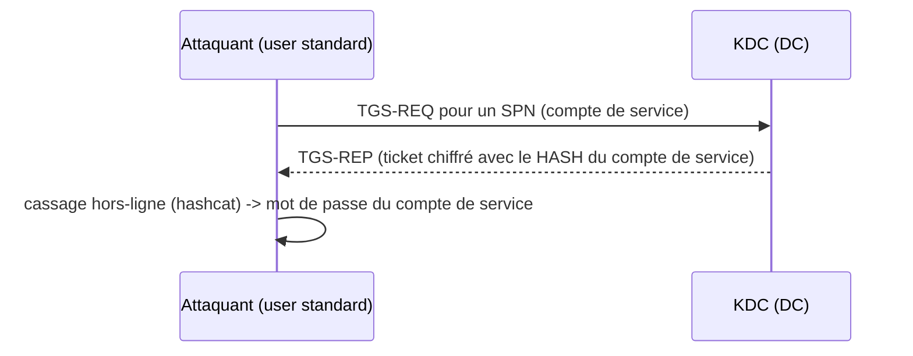

# Fiche — Kerberoasting & AS-REP Roasting

> Volet académique. Deux attaques Kerberos « hors-ligne » emblématiques : récupérer un élément
> chiffré avec le hash d'un compte, puis le **casser** sans interagir davantage. Lab isolé.

## 1. Rôle & utilité (offensive)
Ces attaques transforment un **simple compte de domaine** en moyen d'obtenir le mot de passe d'un
**compte de service** (Kerberoasting) ou d'un compte **sans pré-auth** (AS-REP roasting), par cassage
hors-ligne — donc sans bruit d'authentification répété.

## 2. Kerberoasting

- Tout compte à **SPN** est « roastable » : le TGS est chiffré avec la clé dérivée du mot de passe du
  compte → si le mot de passe est faible, on le casse.
- **RC4** (etype 23) facilite grandement le cassage ; **AES** (17/18) le rend bien plus coûteux.

## 3. AS-REP Roasting
- Vise les comptes avec **DONT_REQ_PREAUTH** (pré-auth Kerberos désactivée).
- Sans pré-auth, le KDC renvoie une **AS-REP** dont une partie est chiffrée avec le hash du compte →
  cassable hors-ligne, **sans même connaître de mot de passe** (juste le nom du compte).

## 4. Pourquoi ça marche
Kerberos chiffre certains éléments avec la clé du compte cible ; si le mot de passe est faible, le
cassage hors-ligne réussit. Les **comptes de service** ont souvent des mots de passe anciens/faibles
et des SPN → cibles idéales.

## 5. Outils
- **Kerberoasting** : `impacket-GetUserSPNs`, **Rubeus** (`kerberoast`), NetExec module.
- **AS-REP** : `impacket-GetNPUsers`, Rubeus (`asreproast`).
- **Cassage** : **hashcat** (modes 13100 Kerberoast RC4, 19600/19700 AES ; 18200 AS-REP), John.

## 6. Objets/attributs liés
- `servicePrincipalName` (Kerberoasting), `userAccountControl` bit `DONT_REQ_PREAUTH` (AS-REP),
  `msDS-SupportedEncryptionTypes` (RC4 vs AES).

## 7. Surface d'attaque
Comptes de service à SPN avec mot de passe faible ; comptes sans pré-auth. Très répandu car hérité.

## 8. Détection (aperçu)
4769 (demande de TGS, surtout **RC4** en volume) pour Kerberoasting ; 4768 (AS-REQ sans pré-auth)
pour AS-REP. Voir `defend.md`.

## 9. Versioning
Le passage **AES-only** + **gMSA/dMSA** neutralise largement ces attaques (mots de passe non
cassables en pratique). RC4 à bannir.

## 10. Pour aller plus loin
*Pentesting AD*, ADSecurity.org, The Hacker Recipes (roasting). Voir `bibliographie.md` (P5).
