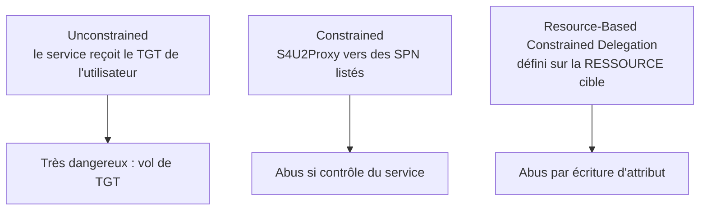

# Fiche — Délégations Kerberos & RBCD

> Volet académique. La délégation Kerberos permet à un service d'agir « au nom de » un utilisateur.
> Mal configurée, elle devient un puissant vecteur d'escalade/mouvement latéral. Lab isolé.

## 1. Rôle & utilité (légitime)
La délégation répond à un besoin réel : un serveur web (front) doit accéder à une base (back) **au
nom de** l'utilisateur. Kerberos propose plusieurs mécanismes pour cela — chacun avec sa surface d'abus.

## 2. Les trois types

- **Unconstrained** : la machine/service reçoit une copie du **TGT** de tout utilisateur qui s'y
  authentifie → si compromis, vol de TGT (ex. forcer un DC à s'y authentifier = TGT du DC).
- **Constrained** : le service peut demander des tickets vers une **liste de SPN** (S4U2Proxy),
  éventuellement avec « protocol transition » (S4U2Self).
- **RBCD** : la délégation est définie **sur la ressource cible** via l'attribut
  `msDS-AllowedToActOnBehalfOfOtherIdentity` → si on peut **écrire** cet attribut, on s'octroie la délégation.

## 3. S4U2Self / S4U2Proxy (les primitives)
- **S4U2Self** : un service obtient un ticket « pour » un utilisateur **vers lui-même**.
- **S4U2Proxy** : avec ce ticket, il en demande un vers un autre service (selon la config de délégation).
- Ces primitives, combinées à une mauvaise config, permettent d'« impersonner » un admin vers un service.

## 4. RBCD en pratique (le vecteur moderne)
Si un attaquant contrôle un compte avec un **SPN** (ou peut créer un compte machine — `ms-DS-MachineAccountQuota`
> 0 par défaut !) et peut **écrire** `msDS-AllowedToActOnBehalfOfOtherIdentity` sur une cible, il
configure une RBCD de sa machine vers la cible → S4U → ticket admin vers la cible.

## 5. Objets/attributs liés
- `userAccountControl` : `TRUSTED_FOR_DELEGATION` (unconstrained), `TRUSTED_TO_AUTH_FOR_DELEGATION`
  (constrained + protocol transition).
- `msDS-AllowedToDelegateTo` (constrained), `msDS-AllowedToActOnBehalfOfOtherIdentity` (RBCD).
- `ms-DS-MachineAccountQuota` (combien de comptes machine un user peut créer — souvent 10).

## 6. Surface d'attaque
- **Unconstrained + coercition** (module 54) : forcer un DC → TGT du DC → DCSync.
- **RBCD** : écriture d'attribut (souvent via une ACL GenericWrite/GenericAll, module 21) → escalade.
- **Constrained + protocol transition** : impersonation vers les SPN autorisés.

## 7. Détection (aperçu)
Modifications de `msDS-AllowedToActOnBehalfOfOtherIdentity` (5136), S4U anormaux (4769), création de
comptes machine (4741). Voir `defend.md`.

## 8. Versioning
`ms-DS-MachineAccountQuota` devrait être mis à 0. Unconstrained à éliminer. RBCD reste un grand
classique d'escalade combiné aux abus d'ACL.

## 9. Pour aller plus loin
*Pentesting AD*, The Hacker Recipes (delegation), SpecterOps (RBCD). Voir `bibliographie.md` (P5).
