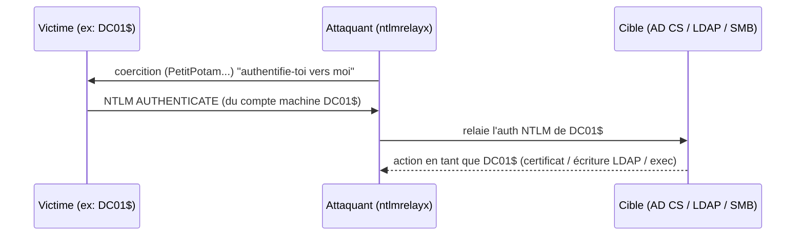

# Fiche — Coercition d'authentification & relais NTLM

> Volet académique. Deux techniques qui se combinent : **forcer** une machine à s'authentifier
> (coercition), puis **relayer** cette authentification NTLM vers un service utile. Lab isolé.

## 1. Rôle & utilité (offensive)
Sans connaître de mot de passe, un attaquant peut déclencher l'authentification d'un compte machine
(souvent un **DC**) et la rediriger vers une cible (AD CS, LDAP, SMB) pour obtenir un accès/certificat
→ escalade jusqu'au domaine.

## 2. Coercition
Des RPC Windows « rappellent » vers un serveur fourni par l'attaquant, déclenchant une authentification
de la machine :
- **PetitPotam** (MS-EFSRPC), **PrinterBug/SpoolSample** (MS-RPRN), **DFSCoerce** (MS-DFSNM),
  **ShadowCoerce** (MS-FSRVP)… agrégés par **Coercer**.

## 3. Relais NTLM

- Le relais fonctionne **si la signature n'est pas imposée** sur la cible (SMB signing, LDAP signing/
  channel binding, EPA sur HTTP).

## 4. Cibles de relais classiques
- **AD CS Web Enrollment (ESC8)** : certificat du DC → PKINIT → DCSync (voir module 43 / solution ESC8).
- **LDAP** (sans signing) : écrire un attribut (ex. RBCD) → escalade (module 53).
- **SMB** (sans signing) : exécution sur une cible.

## 5. Objets/conditions
- Signature SMB/LDAP non requise ; NTLM activé ; coercition accessible (RPC).
- Comptes machine = cibles de choix (le DC a des droits puissants, ex. réplication).

## 6. Surface d'attaque
Chaîne très impactante : **coercition DC + relais LDAP** → RBCD sur le DC ; **+ relais AD CS** → ESC8.
Omniprésente en audit depuis 2021.

## 7. Détection (aperçu)
Appels RPC de coercition (MS-EFSRPC/MS-RPRN), authentifications NTLM de comptes machine vers des hôtes
inattendus, émission de certificats pour comptes machine. Voir `defend.md`.

## 8. Versioning
Mitigations : signature SMB/LDAP + channel binding + EPA, réduction NTLM (déprécié 2025), correctifs
coercition (KB). Microsoft a publié des guides anti-relais AD CS (KB5005413).

## 9. Pour aller plus loin
The Hacker Recipes (coerce/relay), SpecterOps, solution `04-solutions/ESC8-petitpotam-relay.md`.
Voir `99-ressources/bibliographie.md` (P5).
