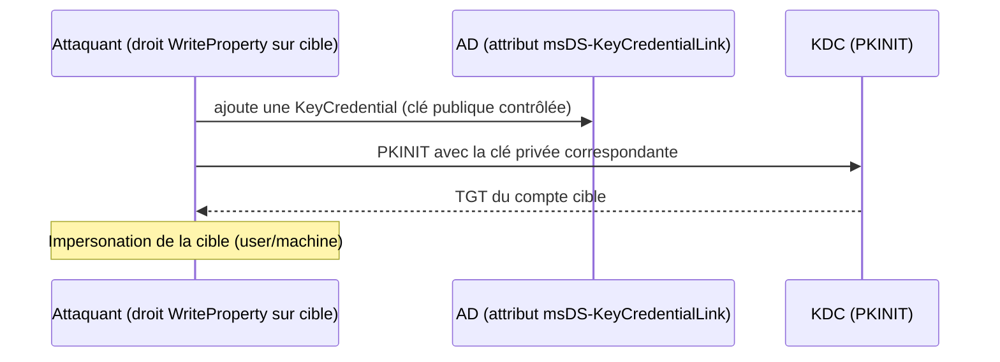

# Fiche — Shadow Credentials (abus de msDS-KeyCredentialLink)

> Volet académique. Une technique d'escalade/persistance « propre » : ajouter une clé d'authentification
> (certificat/clé publique) à un compte via l'attribut `msDS-KeyCredentialLink`, pour s'authentifier
> en tant que ce compte. Lab isolé.

## 1. Rôle & utilité (offensive)
Si on peut **écrire** `msDS-KeyCredentialLink` sur un compte (user ou machine), on y ajoute une paire
de clés contrôlée → on obtient ensuite un **TGT** de ce compte via **PKINIT/Key Trust** (Windows Hello
for Business sous le capot) → impersonation sans connaître le mot de passe.

## 2. Pré-requis
- Un droit d'**écriture** sur l'attribut `msDS-KeyCredentialLink` de la cible : souvent via une ACL
  (GenericWrite/GenericAll/WriteProperty — module 21), ou via RBCD/compte machine contrôlé.
- Un environnement supportant le **Key Trust** (PKINIT) — nécessite une PKI/clé NTAuth ; GOAD est
  configurable pour.

## 3. Fonctionnement

## 4. Outils
- **Whisker** (C#) / **pywhisker** (Python) : manipuler `msDS-KeyCredentialLink`.
- **Rubeus** (asktgt /certificate) / **certipy shadow** : obtenir le TGT via PKINIT, puis le hash NT.
- **certipy shadow auto** : fait toute la chaîne (ajout clé → TGT → NT hash → nettoyage).

## 5. Objets/attributs liés
- `msDS-KeyCredentialLink` (multi-valué, stocke les KeyCredentials).
- ACL de la cible (qui peut écrire cet attribut).

## 6. Surface d'attaque
- Toute ACL permettant d'écrire `msDS-KeyCredentialLink` sur une cible intéressante (ex. un DC, un
  admin). BloodHound marque l'edge **AddKeyCredentialLink**.
- Alternative « plus propre » que le changement de mot de passe (réversible, discret).

## 7. Détection (aperçu)
Modification de `msDS-KeyCredentialLink` (5136), PKINIT inhabituel (4768 PreAuthType 16). Voir `defend.md`.

## 8. Versioning
Dépend du Key Trust (Windows Hello for Business / PKINIT). Mitigation : contrôler les ACL + le mapping
de certificats (KB5014754), limiter qui peut écrire l'attribut.

## 9. Pour aller plus loin
SpecterOps (Shadow Credentials), The Hacker Recipes. Voir `99-ressources/bibliographie.md` (P5).
