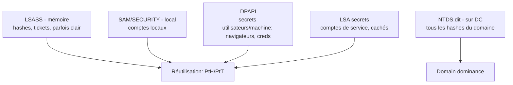

# Fiche — Extraction de credentials (LSASS, SAM, DPAPI, NTDS)

> Volet académique. Une fois un accès obtenu, l'attaquant **récolte des secrets** pour rebondir et
> escalader. Panorama des sources de credentials Windows et de leur extraction. Lab isolé.

## 1. Rôle & utilité (offensive)
Les credentials volés (hash NT, tickets, mots de passe en clair, secrets DPAPI) alimentent le
mouvement latéral (PtH/PtT) et la dominance du domaine (NTDS → krbtgt). C'est le carburant de l'intrusion.

## 2. Les sources

- **LSASS** (mémoire) : hashes NT, tickets Kerberos, parfois mots de passe en clair (WDigest hérité).
- **SAM/SECURITY** (ruches locales) : comptes locaux, LSA secrets, cached domain creds.
- **DPAPI** : chiffre les secrets utilisateurs (mots de passe navigateurs, Credential Manager, etc.)
  et machine ; master keys dérivées du mot de passe/clé de sauvegarde du domaine.
- **NTDS.dit** (sur un DC) : la base des hashes de **tout le domaine** (dont **krbtgt**).

## 3. Techniques d'extraction
- **LSASS** : Mimikatz (`sekurlsa::logonpasswords`), comobjets/`comsvcs.dll MiniDump`, dumps mémoire.
- **SAM/LSA** : `reg save`, impacket `secretsdump` (local), Mimikatz.
- **NTDS** : `ntdsutil`/`vssadmin` snapshot + extraction, ou **DCSync** (réplication, module 26) via
  `secretsdump -just-dc` (préféré : pas besoin d'accès fichier au DC).
- **DPAPI** : Mimikatz `dpapi::`, SharpDPAPI, impacket dpapi.

## 4. Pass-the-Hash / Pass-the-Ticket / OverPtH
- **PtH** : s'authentifier avec le hash NT (NTLM) sans le mot de passe.
- **PtT** : injecter un ticket Kerberos (TGT/TGS) volé.
- **OverPass-the-Hash** : hash NT → demander un TGT (Kerberos).

## 5. Objets/éléments liés
- Process **LSASS**, ruches **SAM/SECURITY/SYSTEM**, fichier **NTDS.dit**, DPAPI master keys,
  droits de réplication (DCSync).

## 6. Surface d'attaque
- LSASS accessible (admin local) ; WDigest activé (clair) ; absence de Credential Guard ; droits de
  réplication trop larges (DCSync).

## 7. Détection (aperçu)
Accès à LSASS (Sysmon 10 vers lsass.exe), `vssadmin`/`ntdsutil` (4688), DCSync (4662 réplication par
non-DC), `reg save` de ruches. Voir `defend.md`.

## 8. Versioning
Mitigations : **Credential Guard** (isole LSASS), WDigest off, LSA Protection (PPL), RunAsPPL,
Protected Users. NTDS/DCSync : restreindre les droits de réplication (module 26).

## 9. Pour aller plus loin
*Windows Security Internals*, The Hacker Recipes (dumping), ADSecurity. Voir `bibliographie.md` (P5, P8).
