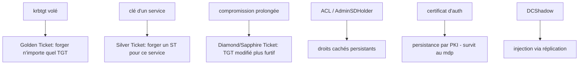

# Fiche — Persistance & dominance du domaine

> Volet académique. Une fois le domaine compromis, l'attaquant veut **rester** malgré les
> remédiations. Panorama des techniques de persistance AD et de ce qu'exige une vraie éradication.

## 1. Rôle & utilité (offensive / compréhension défensive)
La persistance assure un **retour** même après changement de mots de passe/nettoyage. La comprendre
est essentiel côté défense : une mauvaise éradication laisse l'attaquant dans la place.

## 2. Techniques phares

- **Golden Ticket** : avec le hash **krbtgt**, forger des TGT arbitraires (n'importe quel user/groupe)
  → valide tant que krbtgt n'a pas été changé **2 fois**.
- **Silver Ticket** : avec la clé d'un service, forger un ST **pour ce service** (plus ciblé, plus furtif).
- **Diamond/Sapphire Ticket** : variantes plus furtives (TGT légitime modifié) que le Golden.
- **DCSync/DCShadow** : réplication malveillante (vol/injection).
- **AdminSDHolder** : écrire l'ACL du conteneur → SDProp réapplique des droits à l'attaquant partout.
- **Persistance par certificat** : un certificat d'auth valide longtemps, **survit au changement de
  mot de passe** (d'où l'importance de la révocation + rotation krbtgt).
- Autres : skeleton key, SID history, comptes/GPO cachés.

## 3. Pourquoi krbtgt est central
Le krbtgt chiffre tous les TGT. Son vol (DCSync) = capacité à forger des identités. Sa **rotation x2**
est l'étape clé d'une éradication (invalide les Golden Tickets).

## 4. Objets/éléments liés
- Compte **krbtgt**, clés de service, conteneur **AdminSDHolder**, `sIDHistory`, objets nTDSDSA (DCShadow).

## 5. Surface / impact
Persistance = la partie la plus dangereuse : un domaine « nettoyé » superficiellement peut rester
compromis (Golden Ticket, certificats, ACL cachées).

## 6. Détection (aperçu)
TGT anormaux (durée excessive, chiffrement/å PAC incohérents), 4769 pour des services avec ST forgés,
modifs AdminSDHolder (5136), sIDHistory inattendu. Voir `defend.md`.

## 7. Éradication (côté défense)
- **Rotation krbtgt x2** (avec délai de réplication entre les deux).
- **Révoquer** les certificats suspects ; vérifier NTAuth/KeyCredentialLink.
- Auditer **AdminSDHolder**, sIDHistory, comptes/GPO ajoutés.
- En cas de compromission profonde : **Forest Recovery** (module 29).

## 8. Versioning
Diamond/Sapphire tickets plus récents (contournent certaines détections Golden). Durcissements PAC
(2021-2022) compliquent certaines forgeries.

## 9. Pour aller plus loin
ADSecurity (Golden/Silver), The Hacker Recipes, *Pentesting AD*. Voir `bibliographie.md` (P5).
