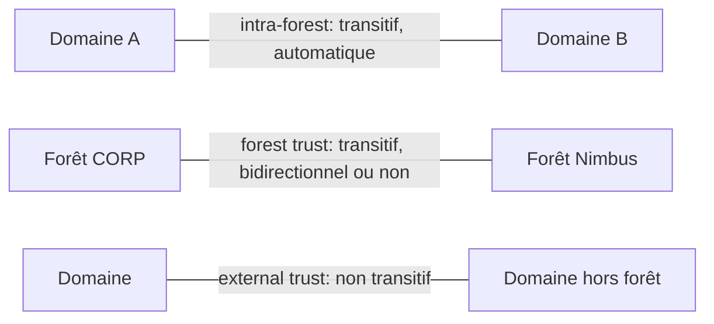

# Fiche — Trusts & attaques cross-forest

> Volet académique. Les relations d'approbation (trusts) relient domaines/forêts. Mal maîtrisées,
> elles permettent de franchir la frontière de sécurité. Scénario GOAD/CORP M&A (`nimbus.local`). Lab isolé.

## 1. Rôle & utilité
Un **trust** permet aux principaux d'un domaine d'accéder aux ressources d'un autre. Fréquent après
fusion-acquisition (CORP ↔ Nimbus). La **forêt** est la vraie frontière de sécurité — un trust de
forêt doit donc être traité avec prudence.

## 2. Types de trusts

- **Intra-forest** : entre domaines d'une même forêt (transitifs, automatiques).
- **Forest trust** : entre deux forêts (transitif au sein des forêts liées).
- **External / Realm** : non transitifs, ciblés.
- **Direction** : unidirectionnel ou bidirectionnel ; **transitivité** ; **SID filtering** (filtre les
  SID « étrangers » — protection clé).

## 3. Mécanismes d'abus
- **SID History** : un ticket portant un `sIDHistory` avec un SID privilégié de l'autre domaine peut
  accorder des droits — **si le SID filtering est désactivé/faible**.
- **Trust key** : la clé du trust permet de forger des **inter-realm TGT** (franchir le trust).
- **Kerberos cross-realm** : referrals entre KDC des domaines approuvés.
- **Abus de ressources partagées** / foreign group membership.

## 4. Intra-forest : pas une frontière de sécurité
Entre domaines d'une **même forêt**, la compromission d'un domaine peut mener à la forêt
(Enterprise Admins, SID history, trust key intra-forest) : d'où « la forêt est la frontière ».

## 5. Objets/attributs liés
- Objets **trustedDomain** ; `trustAttributes` (dont quarantine/SID filtering, transitivité) ;
  `sIDHistory` ; clés de trust.

## 6. Surface d'attaque
- **Forest trust avec SID filtering faible** → escalade cross-forest via SID history.
- **Trust bidirectionnel** large après M&A (Nimbus moins sûr → pivot vers CORP).
- Comptes/groupes « foreign » avec accès.

## 7. Détection (aperçu)
TGT inter-realm anormaux, sIDHistory inattendu (4765/4766), accès cross-domain inhabituels, modifs de
trust (5136 trustedDomain). Voir `defend.md`.

## 8. Versioning
Le **SID filtering** est activé par défaut sur les forest trusts modernes (quarantine), mais souvent
désactivé pour des raisons de compatibilité M&A → à vérifier. Selective Authentication renforce.

## 9. Pour aller plus loin
*Pentesting AD* (trusts), The Hacker Recipes, ADSecurity (SID history / trusts). Voir `bibliographie.md` (P5, P6).
