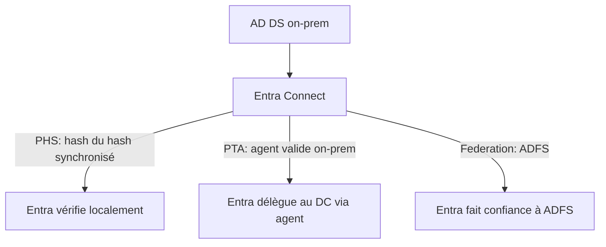

# Fiche — Entra Connect (synchronisation hybride)

> Volet académique. Entra Connect (ex-Azure AD Connect) synchronise l'AD on-prem avec Entra ID. C'est
> le pont de l'hybride — et un composant **Tier 0** critique (sa compromission = clés des deux mondes).

## 1. Rôle & utilité
Entra Connect synchronise utilisateurs/groupes/attributs d'AD DS vers Entra ID et gère
l'authentification hybride. Il permet le SSO entre on-prem et cloud (CORP ↔ tenant).

## 2. Méthodes d'authentification hybride

- **PHS (Password Hash Sync)** : un *hash du hash* NT est synchronisé vers Entra → Entra authentifie
  seul. Résilient (si on-prem tombe, le cloud marche). **Recommandé**.
- **PTA (Pass-Through Authentication)** : un agent on-prem valide le mot de passe contre un DC → pas
  de hash dans le cloud, mais dépend de l'agent (surface d'attaque : agent PTA compromis).
- **Federation (ADFS)** : Entra fait confiance à une fédération on-prem (ADFS) → surface d'attaque
  majeure (Golden SAML si la clé de signature est volée).

## 3. Composants & comptes sensibles
- Serveur **Entra Connect** (Tier 0 !) ; base de config (SQL/LocalDB).
- **Comptes de synchro** : `MSOL_*` (on-prem, droits DCSync-like !) et le connecteur cloud
  (Sync service account dans Entra, souvent très privilégié). **Cibles majeures**.
- **Seamless SSO** : compte **AZUREADSSOACC$** (son hash permet des Silver Tickets cloud — à protéger/roter).

## 4. Fonctionnement de la synchro
- **Connector space** / **metaverse** : moteur de synchro, règles d'attributs, filtres (OU/groupes).
- **Password writeback**, **group/device writeback** : options bidirectionnelles.
- **Soft/Hard match** : association d'objets on-prem ↔ cloud (attention à l'« abus de matching »).

## 5. Objets/attributs liés
- `onPremisesSecurityIdentifier`, `onPremisesImmutableId` (ms-DS-ConsistencyGuid), compte AZUREADSSOACC$.

## 6. Surface d'attaque (aperçu, module 63)
- **Serveur Entra Connect compromis** → extraction des creds de synchro → DCSync on-prem ET
  manipulation cloud (selon droits). 
- **AZUREADSSOACC$** → Silver Ticket vers le cloud.
- **PTA agent** compromis → interception de credentials.
- **ADFS** → Golden SAML (forger des tokens).

## 7. Détection (aperçu)
Activité du compte de synchro, connexions au serveur Connect, modifications de configuration, DCSync
depuis le serveur Connect. Voir `defend.md`.

## 8. Versioning
Entra Connect (v2) ; **Entra Cloud Sync** (agent léger) comme alternative moderne. PHS recommandé par
Microsoft. ADFS en déclin au profit de l'authentification cloud.

## 9. Pour aller plus loin
Microsoft Learn — Entra Connect ; dirkjanm.io (hybride), AADInternals. Voir `bibliographie.md` (P6).
