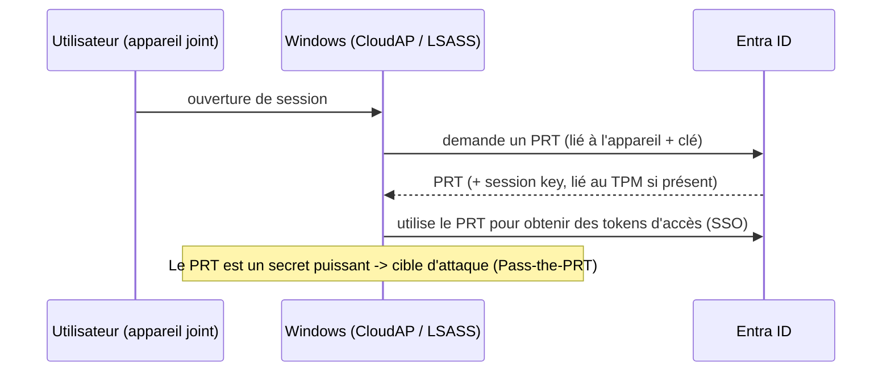

# Fiche — Hybrid Join, SSO & le PRT

> Volet académique. Comment un appareil et un utilisateur obtiennent un SSO fluide entre on-prem et
> cloud — via la jonction hybride et le **PRT**. Comprendre le PRT est clé pour les attaques (module 63).

## 1. Rôle & utilité
La jonction d'appareil à Entra permet le SSO vers les ressources cloud (M365, apps) sans ressaisir
ses identifiants. Le mécanisme central est le **Primary Refresh Token (PRT)**.

## 2. États de jonction d'un appareil
- **Azure AD Joined (AADJ)** : appareil joint uniquement à Entra (cloud-first).
- **Hybrid Azure AD Joined (HAADJ)** : joint à AD DS **et** enregistré dans Entra (CORP typique).
- **Azure AD Registered** : appareil perso enregistré (BYOD).

## 3. Le PRT (Primary Refresh Token)

- Le **PRT** est un token de rafraîchissement « primaire » lié à l'appareil et à l'utilisateur, protégé
  idéalement par le **TPM**. Il permet d'obtenir des access tokens sans réauthentification (SSO).
- Il est géré par **CloudAP** dans LSASS → s'il est extrait (Pass-the-PRT), un attaquant obtient le SSO
  cloud de la victime.

## 4. Seamless SSO (différent du PRT)
Pour les appareils **non** AADJ, Seamless SSO (via AZUREADSSOACC$, module 61) fournit un SSO Kerberos
vers Entra — autre surface (Silver Ticket cloud).

## 5. Objets/éléments liés
- Objet **device** dans Entra, clé d'appareil (TPM), **PRT** (CloudAP/LSASS), AZUREADSSOACC$.

## 6. Surface d'attaque (aperçu, module 63)
- **Pass-the-PRT** : extraire le PRT (+ session key) d'un appareil compromis → SSO cloud de la victime.
- **PRT via cookie** (x-ms-RefreshTokenCredential) → tokens.
- **Device code phishing** (n'a pas besoin du PRT) : faire valider un code par la victime → tokens.

## 7. Détection (aperçu)
Sign-in logs (nouvel appareil/emplacement), utilisation de PRT inhabituelle, enregistrements
d'appareils suspects. Voir `defend.md`.

## 8. Versioning
Le PRT lié au **TPM** complique l'extraction (vs sans TPM). Windows Hello for Business utilise des
clés liées au PRT. Device compliance (Intune) renforce le modèle.

## 9. Pour aller plus loin
dirkjanm.io (PRT, ROADtools), AADInternals. Voir `99-ressources/bibliographie.md` (P6).
