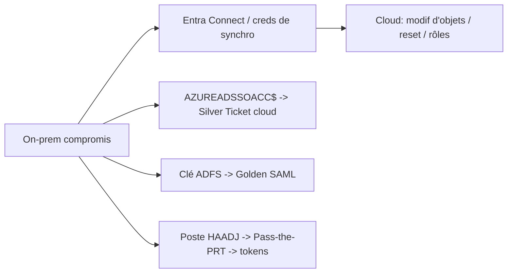

# Fiche — Attaques hybrides & pivots on-prem ↔ cloud

> Volet académique. Synthèse offensive de l'hybride : comment on passe du on-prem au cloud (et
> inversement), en exploitant les ponts (Connect, PRT, apps, tokens). Lab/tenant de test.

## 1. Rôle & utilité (compréhension défensive)
L'hybride crée des **chemins bidirectionnels** : compromettre un côté peut livrer l'autre. Ce module
cartographie ces pivots pour mieux les détecter/couper.

## 2. Pivots on-prem → cloud

- **Entra Connect** compromis → creds de synchro (AADInternals) → actions cloud.
- **AZUREADSSOACC$** → Silver Ticket vers Entra.
- **ADFS** → **Golden SAML** (forger n'importe quel token).
- **Poste HAADJ** → **Pass-the-PRT** → tokens cloud de la victime.

## 3. Pivots cloud → on-prem
- **Intune/Endpoint Manager** compromis → pousser un script sur les machines gérées → exécution on-prem.
- **Entra Connect avec password writeback** → réinitialiser des mots de passe on-prem depuis le cloud.
- **Application/Service principal** avec droits sur des ressources hybrides.
- **Comptes hybrides à privilèges** (admin on-prem synchronisé & admin cloud) — à éviter.

## 4. Attaques purement cloud (rappel module 62)
- **Illicit consent grant** : app malveillante obtient des permissions Graph via consent utilisateur.
- **Service principal abuse** : SP à droits élevés (ajout de secret/cert → persistance).
- **Device code phishing**, **token theft**, **MFA fatigue** (T1621).
- **Rôle privilégié** attribué (Global Admin) → persistance.

## 5. Outils
- **AADInternals** (Nestori Syynimaa), **ROADtools/roadtx** (Dirk-jan Mollema), **TokenTactics**,
  **GraphRunner**, **Certipy** (si PKINIT cloud), Microsoft Graph PowerShell.

## 6. Objets/éléments liés
- Creds de synchro, AZUREADSSOACC$, clé ADFS, PRT, service principals (secrets/certs), rôles Entra,
  consent grants, appareils.

## 7. Le principe « pas de pont de privilège »
Un admin **ne doit pas** être à la fois Tier 0 on-prem **et** Global Admin cloud sur le même compte :
sinon un seul compromis livre les deux mondes. → **comptes séparés** (tiering cloud).

## 8. Détection (aperçu)
Sign-in/audit logs Entra, Graph activity, Identity Protection, et côté on-prem les détections des
phases 2-5. Voir `defend.md`.

## 9. Versioning
Golden SAML (ADFS) historique mais toujours pertinent ; le vol de tokens/PRT en forte hausse. Token
protection et CA modernes réduisent la surface.

## 10. Pour aller plus loin
dirkjanm.io, AADInternals, SpecterOps (cloud). Voir `99-ressources/bibliographie.md` (P6).
