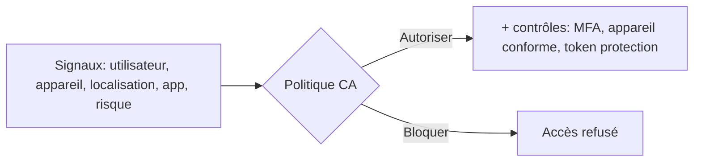

# Fiche — Conditional Access & PIM (durcissement de l'identité cloud)

> Volet académique. Les deux piliers défensifs d'Entra : **Conditional Access** (décider qui accède à
> quoi, sous quelles conditions) et **PIM** (élévation juste-à-temps des rôles). Nécessite Entra ID P2.

## 1. Rôle & utilité
- **Conditional Access (CA)** : des politiques « si [signaux] alors [contrôles] » qui gouvernent chaque
  authentification (MFA, appareil conforme, blocage géographique…). C'est le pare-feu de l'identité.
- **PIM (Privileged Identity Management)** : plus de rôles à privilèges **permanents** ; on **active**
  un rôle à la demande, pour une durée limitée, avec approbation/MFA/justification.

## 2. Conditional Access

- **Conditions (signaux)** : utilisateur/groupe, application, plateforme, localisation (named
  locations), **risque** (Identity Protection), état de l'appareil.
- **Contrôles d'octroi** : exiger **MFA**, **appareil conforme/HAADJ**, mot de passe fort, app
  approuvée, **token protection** (lier le token à l'appareil).
- **Contrôles de session** : durée, réauth, restrictions.
- **Baselines** : bloquer l'**authentification héritée** (legacy auth), MFA admins, etc.

## 3. PIM
- Rôles **éligibles** (à activer) vs **actifs** (permanents, à minimiser).
- Activation : **MFA + justification + approbation** + durée limitée + alertes.
- **Access reviews** : revoir périodiquement qui a quoi.

## 4. Pourquoi c'est central (lien module 63)
CA + PIM cassent une grande partie des attaques cloud : MFA bloque le password spray, l'appareil
conforme gêne le vol de token, PIM supprime les rôles permanents (moins de cibles), token protection
contre le Pass-the-PRT.

## 5. Implémentation
- Portail Entra (Security → Conditional Access ; Identity Governance → PIM) ; Microsoft Graph
  (`Get-MgIdentityConditionalAccessPolicy`, `*-MgRoleManagementDirectory*`).

## 6. Objets/éléments liés
- Politiques CA, named locations, rôles éligibles/actifs (PIM), access reviews, comptes break-glass.

## 7. Surface d'attaque (ce que CA/PIM ferment ou… ouvrent si mal fait)
- **Trous de CA** : exclusions trop larges, legacy auth non bloquée, pas de MFA sur certaines apps →
  contournement.
- **PIM mal configuré** : activation sans MFA/approbation, rôles permanents restants.
- Toujours prévoir des **comptes break-glass** (exclus de CA) **surveillés**.

## 8. Détection
Modifications de politiques CA/PIM (audit logs), activations de rôle PIM, échecs CA, usage des comptes
break-glass. Voir `defend.md`.

## 9. Versioning
CA/PIM/Identity Protection nécessitent **Entra ID P2** (essai 90 j). Token protection en évolution.
Security Defaults (gratuit) couvre le minimum pour les petits tenants.

## 10. Pour aller plus loin
Microsoft Learn — Conditional Access / PIM ; frameworks CA (ex. « CA as code »). Voir `bibliographie.md` (P6).
