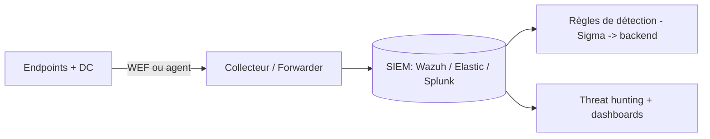

# Fiche — Collecte de logs & SIEM

> Volet académique. Sans centralisation des logs, aucune détection n'est possible. Ce module pose le
> socle Blue Team : quoi collecter, comment, et où (SIEM). Toutes les règles Sigma des phases 4-6
> deviennent exploitables ici.

## 1. Rôle & utilité
Un **SIEM** (Security Information and Event Management) centralise, normalise et corrèle les logs du
parc pour **détecter** et **investiguer**. C'est le cerveau de la détection.

## 2. Que collecter (priorités AD)
- **Contrôleurs de domaine** : Security (4624/4625/4768/4769/4662/5136…), Directory Service (1644),
  DNS, réplication.
- **Serveurs/Postes** : Security, **Sysmon** (module 71), PowerShell Operational (4103/4104), WinRM.
- **AD CS** : audit d'émission (4886/4887), changements (module 43).
- **Entra** (hybride) : sign-in / audit / Graph activity (via connecteur cloud).
- **Réseau/EDR** : télémétrie complémentaire.

## 3. Comment collecter côté Windows

- **WEF (Windows Event Forwarding)** : natif, sans agent tiers (abonnements + collecteur). Robuste.
- **Agents** : Wazuh agent, Elastic Agent/Winlogbeat, Splunk UF — collecte riche + modules sécurité.
- **Audit policy** : activer les bonnes catégories (Advanced Audit Policy via GPO, module 20) — sinon
  les événements n'existent pas.

## 4. Choix de SIEM (pour le lab)
- **Wazuh** : open-source, complet (HIDS + règles + dashboards), facile à déployer en lab.
- **Elastic (ELK) Security** : puissant, détections + ML ; Ludus sait instrumenter les VM avec l'agent Elastic.
- **Splunk** (Free limité), **Microsoft Sentinel** (cloud, pour le volet Entra).

## 5. Pipeline de détection
Événements → normalisation (champs communs) → **règles** (Sigma converties pour le backend) →
alertes → triage → hunting. La **qualité des logs** (audit policy + Sysmon) conditionne tout.

## 6. Dimensionnement & rétention
Prévoir la rétention (journaux volumineux : 4662/4769), le filtrage (bruit), et le stockage. En lab,
cibler les DC + quelques endpoints.

## 7. Surface d'attaque (côté défense)
Les attaquants **effacent/désactivent** les logs (T1070) ou le SIEM. D'où : collecte **au fil de
l'eau** (forward immédiat), intégrité, et comptes du SIEM protégés (Tier 0-like).

## 8. Détection de la manipulation de logs
Effacement du journal Security (1102), arrêt de services de log, désactivation d'audit. Voir `defend.md`.

## 9. Versioning
WEF natif reste valable ; Elastic/Wazuh évoluent vite (vérifier versions). Sentinel pour l'hybride.

## 10. Pour aller plus loin
Docs Wazuh/Elastic, SwiftOnSecurity (Sysmon), Elastic Security Labs (GOAD+Ludus). Voir `bibliographie.md` (P7).
