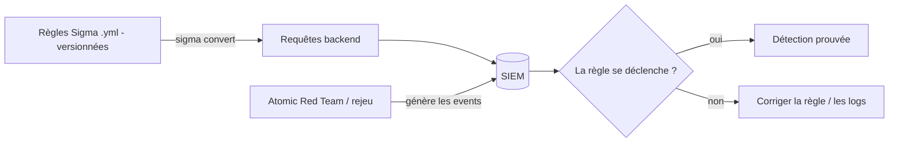

# Fiche — Détection as code : Sigma par attaque

> Volet académique. Sigma est un format **portable** de règles de détection. Ce module **centralise**
> toutes les règles semées dans les modules précédents, les convertit pour le SIEM, et les **prouve**.

## 1. Rôle & utilité
Sigma décrit une détection indépendamment du SIEM (YAML), puis un **convertisseur** (sigma-cli/pySigma)
la traduit vers le backend cible (Elastic, Wazuh, Splunk, Sentinel/KQL…). Avantage : écrire **une fois**,
déployer **partout**, versionner comme du code.

## 2. Anatomie d'une règle Sigma
```yaml
title: <nom>
logsource:            # d'où viennent les événements
  product: windows
  service: security   # ou sysmon, powershell...
detection:
  selection:          # conditions
    EventID: 4769
    TicketEncryptionType: '0x17'
  condition: selection
level: high
tags:                 # mapping MITRE ATT&CK
  - attack.t1558.003
```
- **logsource** : product/service/category (doit matcher la normalisation du SIEM).
- **detection** : selections + condition (and/or/count/timeframe).
- **level** + **tags** (ATT&CK) pour la priorisation et le reporting.

## 3. Le pipeline « détection as code »


## 4. Catalogue (ce module regroupe les règles des phases 4-6)
- **Kerberos** : Kerberoasting (4769 RC4), énum Kerberos (4768).
- **ACL/délégation** : 5136 (nTSecurityDescriptor, RBCD, KeyCredentialLink).
- **AD CS/ESC** : 4886 (cert compte machine), 5136 (templates).
- **Credentials** : Sysmon 10 (LSASS), DCSync (4662), vssadmin (T1490).
- **Persistance** : AdminSDHolder (5136), sIDHistory (4765/4766).
- **Évasion** : 1102 (clear log), Sysmon 16 (config).
- **Hybride** : KQL (consent, role add, break-glass).
Les fichiers sont dans `automate/rules/`.

## 5. Convertir & tester
- **sigma-cli** (`sigma convert -t <backend>`), **pySigma** + pipelines. Tester contre des logs réels
  (rejeu, module 74).

## 6. Qualité d'une règle
- **Vrais positifs** vs **faux positifs** (affiner les filtres), couverture ATT&CK, performance
  (éviter les requêtes trop larges), maintenabilité.

## 7. Surface / limites
Une règle ne vaut que si **les logs existent** (audit policy + Sysmon) et **arrivent** (SIEM). D'où la
dépendance aux modules 70-71. Une règle non testée = fausse sécurité.

## 8. Reporting (compétence Blue)
Maintenir une **matrice de couverture ATT&CK** (quelles techniques détectées), issue du journal
offensif (module 50). Les trous = backlog de détection.

## 9. Versioning
SigmaHQ (dépôt communautaire) évolue ; versionner tes règles, suivre les mises à jour, et re-tester.

## 10. Pour aller plus loin
SigmaHQ, pySigma, MITRE ATT&CK/D3FEND. Voir `99-ressources/bibliographie.md` (P7).
