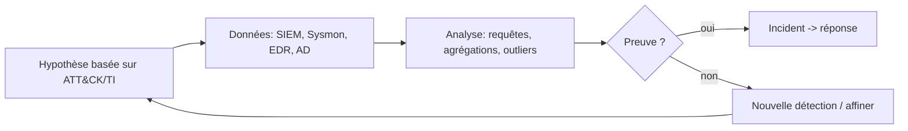

# Fiche — Threat Hunting

> Volet académique. Le hunting est la recherche **proactive** de menaces qui ont échappé aux
> détections automatiques. Il complète les règles (module 72) par l'investigation guidée par hypothèses.

## 1. Rôle & utilité
Les règles détectent le **connu**. Le threat hunting cherche le **non détecté** : hypothèses sur le
comportement d'un attaquant, puis recherche de preuves dans les données (SIEM, EDR, BloodHound).

## 2. Démarche (hypothesis-driven)

- **Hypothèse** : « un attaquant a fait du Kerberoasting » / « un compte machine a demandé un certificat ».
- **Données** : logs centralisés, Sysmon, EDR, graphe BloodHound.
- **Résultat** : incident, OU une nouvelle **règle** (le hunting nourrit la détection, module 72).

## 3. Sources & techniques
- **SIEM** (requêtes, agrégations, détection d'outliers), **Sysmon**, **EDR** (Velociraptor pour la
  chasse à l'échelle), **BloodHound** (chemins d'attaque), threat intelligence (IoC/TTP).
- **Stacking/least-frequency** : chercher le rare (process, parent, destination réseau inhabituels).
- **Baselining** : connaître le normal pour repérer l'anormal.

## 4. Pistes de hunting AD (exemples)
- 4769 RC4 anormaux (Kerberoasting), 4768 sans pré-auth, 4662 réplication par non-DC (DCSync).
- 4886 cert pour compte machine (ESC8), 5136 sur attributs sensibles (RBCD, KeyCredentialLink).
- Sysmon 10 vers lsass, 1 avec encoded cmd, 3 vers destinations inhabituelles (C2).
- Logons Tier 0 hors Tier 0 (violation de tiering, module 22).
- Nouveaux SPN/comptes/GPO, appartenances de groupes sensibles récentes.

## 5. Outillage
- **Velociraptor** (chasse & collecte à l'échelle, artefacts VQL), requêtes SIEM (KQL/EQL/Lucene),
  **BloodHound** (défensif), Jupyter/pandas pour l'analyse.

## 6. Hunting hybride
Côté Entra : sign-in anormaux, consent grants, nouveaux secrets d'app, usage de tokens depuis des
appareils inconnus (KQL sur sign-in/audit logs).

## 7. Du hunt à la détection
Tout hunt fructueux doit produire une **règle** (module 72) pour automatiser la détection à l'avenir.
C'est la boucle d'amélioration continue.

## 8. Reporting
Documenter chaque hunt : hypothèse, données, requêtes, résultat, action (nouvelle règle / incident).
Alimente la matrice de couverture ATT&CK.

## 9. Versioning
Les TTP évoluent : rejouer les hunts périodiquement, suivre la threat intel.

## 10. Pour aller plus loin
MITRE ATT&CK, Velociraptor docs, The DFIR Report (cas réels). Voir `99-ressources/bibliographie.md` (P7).
