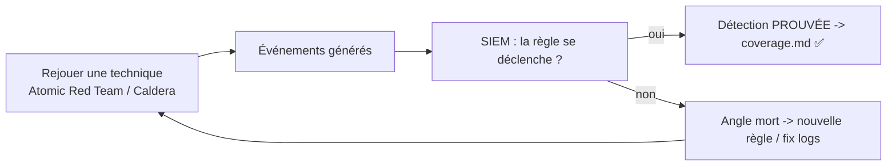

# Fiche — Purple Team : prouver les détections

> Volet académique. Le purple team ferme la boucle rouge↔bleu : rejouer des attaques de façon
> **contrôlée et répétable**, et **vérifier** que les détections (module 72) se déclenchent. C'est ce
> qui transforme des règles « supposées » en détections **prouvées**.

## 1. Rôle & utilité
Au lieu d'opposer red et blue, le purple team **collabore** : l'attaque sert à **valider et améliorer**
la détection. Objectif : couverture ATT&CK mesurée, règles prouvées, angles morts identifiés.

## 2. La boucle purple (cœur du workbook)

## 3. Outils de rejeu
- **Atomic Red Team** : tests atomiques par technique ATT&CK (`Invoke-AtomicTest T1558.003`),
  légers, documentés, avec cleanup.
- **MITRE Caldera** : émulation d'adversaire automatisée (chaînes complètes, agents).
- **Scripts de lab** du workbook (modules 52-58) comme alternative.

## 4. Méthode
1. Choisir une technique (ATT&CK) et la règle censée la détecter.
2. **Rejouer** (Atomic/Caldera) dans le lab.
3. **Observer** le SIEM : alerte ? dans quel délai ? champs corrects ?
4. **Statuer** : prouvée (coverage.md ✅) ou angle mort (créer/corriger la règle, module 72).
5. **Nettoyer** (cleanup Atomic) et répéter.

## 5. Mesurer la couverture
- **Matrice ATT&CK** (`coverage.md`, module 72) : % de techniques détectées.
- **ATT&CK Navigator** : visualiser la couverture (heatmap).
- Indicateurs : taux de détection, délai, faux positifs.

## 6. Purple hybride
Rejouer des techniques cloud (device code, consent) et vérifier les détections KQL (sign-in/audit).
Certains tests Atomic couvrent Azure/Entra.

## 7. Cadence
Purple **récurrent** (ex. mensuel) + après chaque changement majeur (nouvelle attaque apprise, nouveau
durcissement) → régression de détection.

## 8. Du purple au durcissement
Une technique **non détectée** ET **non bloquée** = double angle mort → prioriser (détection ET
contrôle préventif, phases 2-4/6).

## 9. Versioning
Atomic Red Team / Caldera évoluent ; épingler les versions pour la reproductibilité, re-tester après
mise à jour.

## 10. Pour aller plus loin
Atomic Red Team (Red Canary), MITRE Caldera, Elastic Security Labs (GOAD+Ludus+Elastic purple).
Voir `99-ressources/bibliographie.md` (P7).
