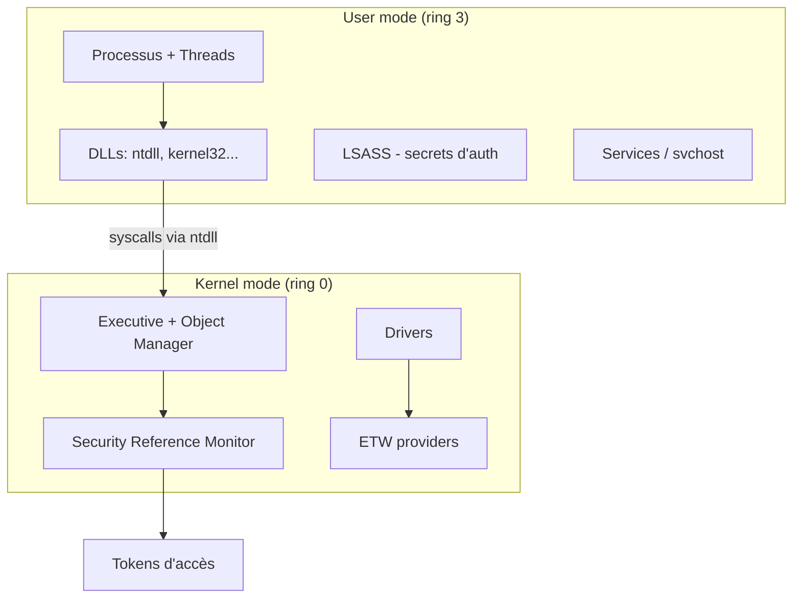

# Fiche — Windows Internals (l'essentiel pour la sécurité)

> Volet académique. Comprendre le fonctionnement interne de Windows explique **pourquoi** les attaques
> marchent et **comment** les détecter. Orienté compréhension & détection (pas production d'outils offensifs).

## 1. Rôle & utilité
La plupart des techniques AD/offensives exploitent des mécanismes internes (processus, tokens, mémoire,
appels système). Les connaître = lire la télémétrie avec sens et concevoir de meilleures détections.

## 2. Architecture (vue sécurité)

- **User mode / Kernel mode** : isolation des privilèges ; la frontière est traversée par des **syscalls**.
- **Object Manager** : tout est objet (fichiers, process, clés) avec un **security descriptor** (ACL).
- **SRM (Security Reference Monitor)** : applique les décisions d'accès (token vs ACL).

## 3. Processus, threads, DLL
- **Processus** : espace d'adressage + token + handles. **Parent/enfant** (lineage → détection).
- **DLL** : chargement (légitime vs **sideloading**/injection, Sysmon 7/8).
- **Handles** : références à des objets (ex. handle vers LSASS = dump de creds).

## 4. Authentification interne
- **LSASS** : héberge les SSP (Kerberos, NTLM, msv1_0, WDigest…) et les secrets en mémoire (module 82).
- **LSA** : autorité de sécurité locale ; **LSA secrets**, tokens.
- **SAM** : base des comptes locaux.

## 5. Mécanismes de sécurité clés
- **Tokens d'accès** (module 81) : identité + privilèges d'un process/thread.
- **Integrity levels**, **UAC**, **sessions**.
- **PPL (Protected Process Light)** : protège certains process (ex. LSASS avec RunAsPPL).
- **ETW** (module 83) : la télémétrie interne (sur laquelle reposent EDR/Sysmon).

## 6. Pourquoi ça compte pour la détection
- Comprendre le **parentage** de process → repérer l'anormal (ex. `winword.exe`→`powershell.exe`).
- Comprendre **handles/ProcessAccess** → détecter l'accès à LSASS (Sysmon 10).
- Comprendre **ETW** → savoir ce qu'un EDR voit… et ce qu'une évasion coupe (module 83).

## 7. Outils d'observation (Sysinternals)
- **Process Explorer / Process Monitor** (process, handles, DLL, activité), **Autoruns** (persistance),
  **WinObj** (objets), **Handle**, **ETW** (logman/PerfView).

## 8. Surface d'attaque (transversale)
Injection de process, token manipulation, accès mémoire (LSASS), abus de drivers (BYOVD), évasion ETW/
AMSI — tous détaillés dans les modules 81-84.

## 9. Versioning
Windows évolue (VBS, HVCI, Credential Guard, protections kernel). Les internals restent le socle.

## 10. Pour aller plus loin
*Windows Internals* (Russinovich et al.), *Windows Security Internals* (Forshaw). Voir `bibliographie.md` (P8).
