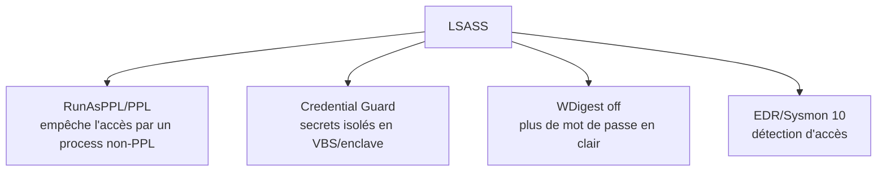

# Fiche — LSASS & DPAPI en profondeur

> Volet académique. Deux mécanismes au cœur des secrets Windows : **LSASS** (où vivent les secrets
> d'authentification en mémoire) et **DPAPI** (comment Windows chiffre les secrets utilisateurs/machine).
> Orienté compréhension & détection.

## 1. LSASS (Local Security Authority Subsystem Service)
Process user-mode qui gère l'authentification et conserve en mémoire : hashes NT, tickets Kerberos,
clés de session, parfois mots de passe (WDigest hérité). C'est **la** cible du vol de credentials (module 56).

### Ce que LSASS contient (selon config)
- **msv1_0** : hashes NT/LM, cached domain creds.
- **Kerberos** : TGT/TGS, clés.
- **WDigest** : mot de passe en clair **si activé** (désactivé par défaut depuis Win8.1/2012R2).
- **tspkg, livessp, kerberos**… : divers SSP.

### Protections LSASS

## 2. DPAPI (Data Protection API)
API Windows qui chiffre/déchiffre des secrets **par utilisateur** (ou **machine**) sans que l'app gère
les clés : mots de passe navigateurs, Credential Manager, clés privées, secrets d'apps, etc.

### Fonctionnement
- **Master key** par utilisateur, dérivée du **mot de passe** (ou de la clé de sauvegarde du domaine,
  **DPAPI domain backup key**, détenue par les DC).
- Les secrets sont stockés en **blobs** DPAPI, déchiffrables avec la master key.
- La **domain backup key** permet de déchiffrer les blobs DPAPI de **tous** les utilisateurs du domaine
  (cible très puissante si le DC est compromis).

## 3. Pourquoi c'est critique
- **LSASS** : un dump = hashes/tickets → PtH/PtT (module 56).
- **DPAPI** : accès aux secrets « applicatifs » (navigateurs, RDP creds, etc.) ; la **domain backup key**
  = déchiffrement massif.

## 4. Objets/éléments liés
- Process LSASS, SSP, master keys DPAPI (`%APPDATA%\Microsoft\Protect\<SID>\`), domain backup key (DC),
  Credential Manager.

## 5. Surface d'attaque
- Dump LSASS (SeDebug/admin), extraction DPAPI (SharpDPAPI, Mimikatz `dpapi::`), vol de la domain
  backup key (DCSync-like sur le DC).

## 6. Détection (aperçu)
Sysmon 10 (accès LSASS), accès aux master keys DPAPI, lecture de la backup key sur le DC. Voir `defend.md`.

## 7. Durcissement
Credential Guard, RunAsPPL, WDigest off, protéger la domain backup key (DC = Tier 0), EDR.

## 8. Versioning
Credential Guard renforcé (VBS) ; DPAPI-NG pour certains scénarios cloud/CNG. WDigest off par défaut.

## 9. Lien modules
Complète le module 56 (dump) par le **pourquoi** interne ; relié à 80 (internals) et 81 (privilèges).

## 10. Pour aller plus loin
*Windows Internals* (LSA), *Windows Security Internals*, SharpDPAPI docs. Voir `bibliographie.md` (P8).
