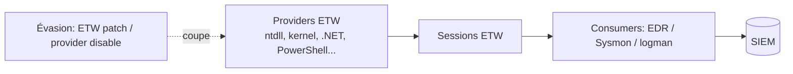
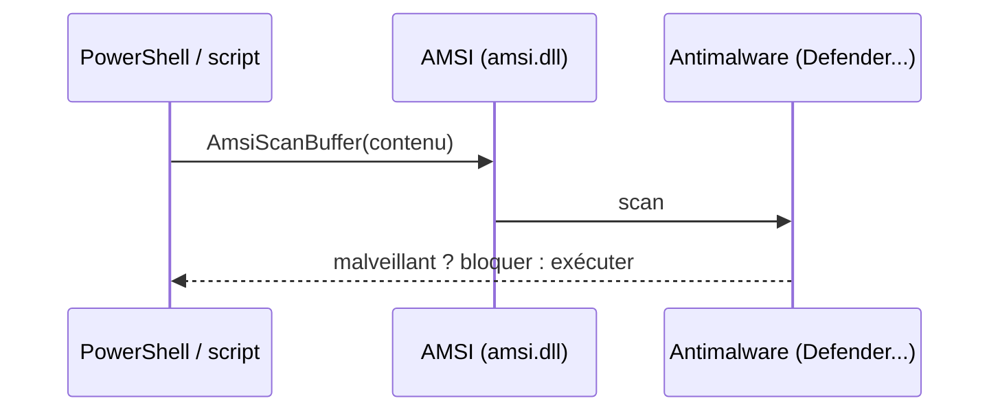

# Fiche — ETW & AMSI (télémétrie et scan, et leur évasion)

> Volet académique. ETW et AMSI sont deux piliers de la visibilité Windows. Les attaquants cherchent à
> les **aveugler**. Comprendre leur fonctionnement = savoir détecter leur contournement. Orienté défense.

## 1. ETW (Event Tracing for Windows)
Infrastructure de traçage haute performance : des **providers** émettent des événements, des
**consumers** (EDR, Sysmon, logman) les collectent. C'est la **source de télémétrie** de la plupart des
EDR (ex. `Microsoft-Windows-Threat-Intelligence` en kernel).

### Providers utiles (détection)
- **Microsoft-Windows-Threat-Intelligence** (ETW-TI, kernel, réservé PPL/anticheat/EDR).
- **PowerShell** (script block logging via ETW), **.NET (CLR)**, **DNS**, **WinINet**.

## 2. AMSI (Antimalware Scan Interface)
Interface qui permet à une application (PowerShell, VBScript, Office macros, .NET) de **soumettre** du
contenu à l'antimalware **avant exécution** — y compris du code généré dynamiquement (fileless).

## 3. Techniques d'évasion (à détecter)
- **ETW patch** : patcher `EtwEventWrite`/`ntdll` en mémoire pour supprimer la télémétrie d'un process.
- **AMSI bypass** : patcher `AmsiScanBuffer`/`amsiInitFailed`, obfuscation, chargement reflété.
- **Provider tampering** : désactiver/filtrer des providers ETW, stopper des sessions (logman).
- **Unhooking** : retirer les hooks user-mode de l'EDR (restaurer ntdll « propre »).

## 4. Pourquoi ça compte
Beaucoup d'EDR reposent sur des **hooks user-mode** + ETW. Les connaître explique **les angles morts**
et pourquoi la détection doit combiner plusieurs sources (user-mode, ETW-TI kernel, Sysmon, comportement).

## 5. Objets/éléments liés
- `ntdll!EtwEventWrite`, `amsi.dll!AmsiScanBuffer`, sessions ETW, providers, hooks EDR.

## 6. Surface d'attaque
- Évasion de la télémétrie (ETW/AMSI/unhooking) pour exécuter du code sans alerte.

## 7. Détection de l'évasion (le cœur du module)
- **Incohérences** : PowerShell qui s'exécute sans events 4104 attendus (ETW coupé).
- **Modifications mémoire** de ntdll/amsi (EDR avancé, ETW-TI).
- **AMSI bypass signatures** (chaînes connues), échecs d'init AMSI.
- **Sessions ETW** stoppées / providers désactivés.
Voir `defend.md`.

## 8. Versioning
Microsoft renforce AMSI/ETW ; ETW-TI (kernel) plus difficile à patcher que l'ETW user-mode. Les EDR
modernes ajoutent des capteurs kernel pour réduire les angles morts.

## 9. Lien modules
Complète 30 (PowerShell logging), 71 (Sysmon), 84 (EDR). Les livres *Evading EDR* / *Evasive Malware*
nourrissent ce module **côté détection**.

## 10. Pour aller plus loin
*Evading EDR* (Matt Hand), *Evasive Malware*, docs ETW/AMSI. Voir `99-ressources/bibliographie.md` (P8).
