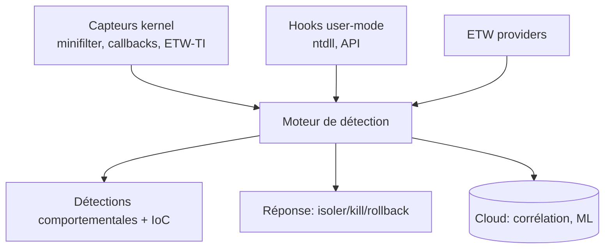

# Fiche — EDR : comprendre pour mieux détecter

> Volet académique (synthèse Phase 8). Comment fonctionne un EDR, ses capteurs, ses angles morts, et
> comment écrire des détections robustes. Orienté défense (livres *Evading EDR* / *Evasive Malware*
> utilisés côté compréhension/détection).

## 1. Rôle & utilité
Un **EDR (Endpoint Detection & Response)** collecte de la télémétrie endpoint, détecte des
comportements malveillants et permet la **réponse** (isolation, kill, remediation). C'est le capteur
central de la défense moderne, complémentaire du SIEM.

## 2. Comment un EDR « voit »

- **Capteurs kernel** : callbacks (process/thread/image), minifilter (fichiers), ETW-TI → robustes.
- **Hooks user-mode** : interception d'API dans le process → riches mais **contournables** (unhooking).
- **ETW** : complément (PowerShell, .NET, DNS…).
- **Cloud/ML** : corrélation et détection comportementale.

## 3. Modèles de détection
- **IoC** (hash, IP, signatures) : rapide mais fragile (évasion facile).
- **Comportemental/heuristique** : séquences d'actions (ex. Office→PowerShell→LSASS) → plus robuste.
- **ATT&CK-aligned** : détections mappées aux TTP.

## 4. Angles morts (ce que les livres enseignent côté défense)
- **Unhooking** / syscalls directs → contourne les hooks user-mode (d'où l'importance du kernel/ETW-TI).
- **ETW/AMSI patch** (module 83).
- **LOLBins** / living-off-the-land → ressemble à du légitime.
- **BYOVD** → désactiver l'EDR via un driver vulnérable.
- **Tampering** : stopper/désinstaller l'agent EDR.

## 5. Durcir l'EDR lui-même
- **Tamper protection** (empêcher l'arrêt/désinstallation), capteurs **kernel** activés, mode bloquant,
  intégrité de l'agent, alertes sur l'arrêt du service.

## 6. Détection « defense-in-depth »
Aucun capteur n'est infaillible → **combiner** EDR (kernel) + Sysmon + SIEM + hunting + comportemental.
Les angles morts d'une couche sont couverts par une autre.

## 7. EDR vs Sysmon vs SIEM
- **Sysmon** : télémétrie riche gratuite (mais pas de réponse, contournable).
- **EDR** : télémétrie + **réponse** + cloud/ML + tamper protection.
- **SIEM** : corrélation multi-sources + règles + hunting.
Les trois sont complémentaires (le workbook les utilise ensemble).

## 8. Surface / évasion
Cf. modules 80-83 : injection, token, LSASS, ETW/AMSI, unhooking, BYOVD. Ce module **synthétise** la
détection de ces évasions.

## 9. Versioning
Les EDR renforcent les capteurs kernel et la tamper protection ; les évasions évoluent (course
perpétuelle). D'où l'importance du **purple team continu** (module 74).

## 10. Pour aller plus loin
*Evading EDR* (Matt Hand), *Evasive Malware* (Kyle Cucci), Elastic Security Labs. Voir `bibliographie.md` (P8).
