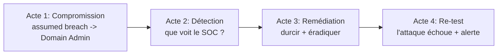

# Fiche — Capstone : compromission → détection → remédiation → re-test

> Volet académique & synthèse finale. Le capstone réunit TOUT le workbook en un scénario de bout en
> bout, joué en purple team dans CORP + GOAD-X. C'est l'épreuve qui valide l'expertise acquise.

## 1. Objectif
Démontrer la maîtrise complète : attaquer un AD réaliste, **détecter** chaque étape, **remédier**, puis
**re-tester** pour prouver que les contre-mesures tiennent. C'est la boucle du workbook à grande échelle.

## 2. Déroulé en 4 actes

### Acte 1 — Compromission (phases 4-6)
Chaîne réaliste, ex. : recon BloodHound (51) → Kerberoasting (52) → ACL/Shadow Creds (21/55) →
coercition+relais ESC8 (54/43) → DCSync krbtgt (56) → Golden Ticket (57) → pivot hybride (63).

### Acte 2 — Détection (phase 7)
Pour chaque étape, vérifier l'alerte (règles Sigma, module 72) et compléter la **matrice ATT&CK**
(coverage.md). Les étapes non détectées = angles morts.

### Acte 3 — Remédiation (phases 2-4-6)
Appliquer les durcissements : tiering (22), LAPS (24), AES/gMSA (16/52), ESC fix (43), signature/NTLM
(15/17/54), mapping fort (40/43), CA/PIM (64), rotation krbtgt x2 (57).

### Acte 4 — Re-test
Rejouer la même chaîne contre CORP durci : chaque étape doit **échouer** ET **déclencher une alerte**
(défense en profondeur). Documenter le delta avant/après.

## 3. Livrables (compétences d'expert)
- **Rapport de pentest** (template module 50) : chemin d'attaque, preuves, impact.
- **Rapport de remédiation** : correctifs priorisés, avant/après.
- **Matrice de couverture ATT&CK** (coverage.md) remplie.
- **Journal de bord** complet (module 50).

## 4. Critères de réussite
- Chaîne d'attaque complète documentée ET mappée ATT&CK.
- ≥ X% des étapes détectées (viser une couverture large).
- Re-test : l'attaque initiale ne fonctionne plus ; alertes levées.

## 5. Variantes / montée en difficulté
- Scénario « assumed breach » vs « externe ».
- Ajouter le volet **hybride** (pivot cloud) et **cross-forest** (M&A Nimbus).
- Chronométrer (temps de détection / de remédiation).

## 6. Lien PingCastle / BloodHound (avant/après)
Mesurer la posture avec **PingCastle**/Purple Knight et **BloodHound** avant et après remédiation
(score + chemins vers Tier 0) → preuve chiffrée du progrès.

## 7. Pour aller plus loin
Toutes les phases ; *Pentesting AD* (méthodo), Trimarc/SpecterOps (remédiation). Voir `bibliographie.md`.
