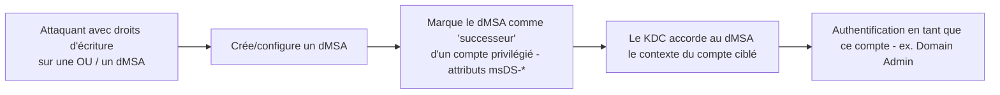

# Fiche — Windows Server 2025 : nouveautés AD & dMSA/BadSuccessor

> Volet académique (conclusion). Server 2025 modernise AD DS — et introduit les **dMSA**, à l'origine
> d'une escalade majeure (**BadSuccessor**). Ce module fait évoluer CORP vers 2025 et étudie la nouvelle
> surface. Lab isolé pour la partie offensive.

## 1. Nouveautés AD de Server 2025
- **Nouveau niveau fonctionnel** de domaine/forêt **Windows Server 2025** (schéma mis à jour) — requis
  pour certaines fonctions.
- **dMSA (delegated Managed Service Accounts)** : nouvelle génération de comptes de service, conçue pour
  **remplacer** un compte de service existant (migration « successeur »).
- **32K database pages**, **support NUMA** (lève la limite ~64 cœurs), **replication priority boost**,
  nouveaux compteurs de perf.
- **Sécurité** : améliorations Kerberos pour **réduire NTLM** (IAKerb, **Local KDC**, SPN par IP),
  LDAP channel binding renforcé, Protected Users.
- **Dépréciations** : **NTLM** (déprécié), **WSUS** (déprécié), WMIC, etc.

## 2. dMSA : principe
Un **dMSA** est un compte de service géré (comme un gMSA) mais qui supporte la **succession** : on le
configure pour **remplacer** un ancien compte de service, et il « hérite » de l'accès/contexte
d'authentification de ce compte via des attributs dédiés.

## 3. BadSuccessor (escalade via dMSA, 2025)

- **Idée** : si un attaquant peut **créer** un dMSA (ou écrire ses attributs de succession) dans une OU
  sur laquelle il a des droits (ex. `CreateChild` sur une OU), il peut le désigner comme successeur
  d'un compte **privilégié** → obtenir un TGT/contexte de ce compte **sans** compromettre ce compte.
- **Gravité** : escalade vers Domain Admin à partir de droits relativement modestes (écriture sur une OU),
  d'où un fort impact. Découverte/publiée en 2025 (Akamai), surnommée **BadSuccessor**.
- **Pré-requis** : au moins un DC Windows Server 2025 (les dMSA en dépendent) + droits d'écriture adéquats.

## 4. Attributs impliqués
- `msDS-ManagedAccountPrecededByLink` (le lien de succession), `msDS-DelegatedMSAState`, et les attributs
  de gMSA sous-jacents. Les surveiller est clé pour la détection.

## 5. Pourquoi l'inclure dans le workbook
Montre comment une **nouvelle fonctionnalité** crée une **nouvelle surface d'attaque** : illustration
parfaite de la veille nécessaire à l'expertise (et de « comprendre pour défendre »).

## 6. Détection (aperçu)
Création de dMSA, écriture des attributs de succession (`msDS-ManagedAccountPrecededByLink`), authentifs
dMSA inhabituelles. Voir `defend.md`.

## 7. Durcissement
Restreindre qui peut **créer** des objets dMSA et écrire leurs attributs (ACL sur les OU) ; traiter ce
droit comme Tier 0 ; surveiller les attributs ; appliquer les correctifs.

## 8. Migration CORP vers 2025
Élever le niveau fonctionnel sur une copie de CORP pour **comparer** la surface d'attaque (dMSA, NTLM
réduit) — exactement l'objectif « voir l'évolution » du PROJECT.md.

## 9. Versioning
Niveau fonctionnel 2025 nécessaire pour dMSA. NTLM/WSUS dépréciés → planifier Kerberos-only + Azure
Update Manager/WUfB.

## 10. Pour aller plus loin
MS Learn (what's new Server 2025), recherche BadSuccessor (Akamai/Tarlogic). Voir `bibliographie.md` (P9).
