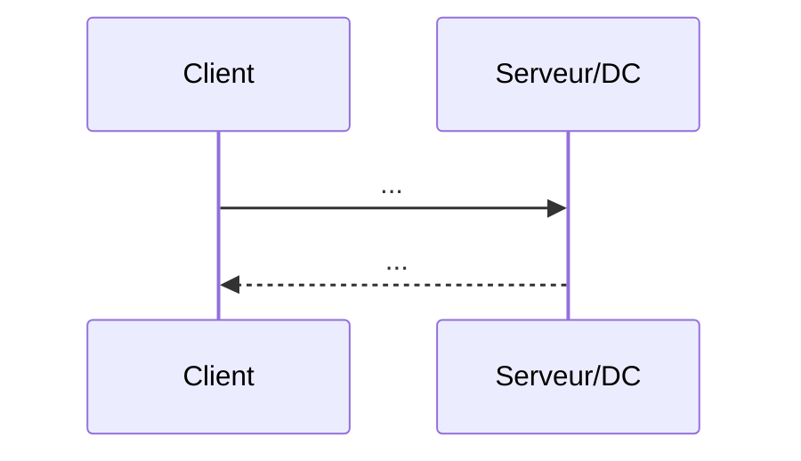

# Fiche — <SUJET>

> Volet académique : comprendre en profondeur avant de pratiquer.

## 1. Rôle & utilité
<À quoi ça sert, dans quel contexte AD/Windows.>

## 2. Fonctionnement
<Mécanisme détaillé. Inclure un schéma d'échange (Mermaid ou ASCII).>

## 3. Implémentation Windows
- Service / process concerné :
- Ports :
- Clés de registre / fichiers :

## 4. Objets & attributs AD concernés
<Classes, attributs, ACL pertinents.>

## 5. Surface d'attaque
<Comment c'est abusé — vue d'ensemble, renvoi vers attack.md.>

## 6. Détection
- Event IDs :
- ETW / sources :
- Règle Sigma (renvoi vers defend.md) :

## 7. Durcissement
<Contrôles recommandés, renvoi vers defend.md.>

## 8. Versioning (2016 → 2019 → 2022 → 2025)
<Ce qui change selon la version, dépréciations.>

## 9. Pour aller plus loin
<Références de 99-ressources/bibliographie.md, pointées par thème.>
